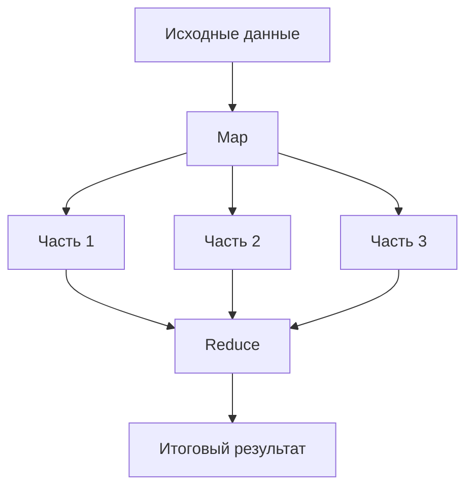
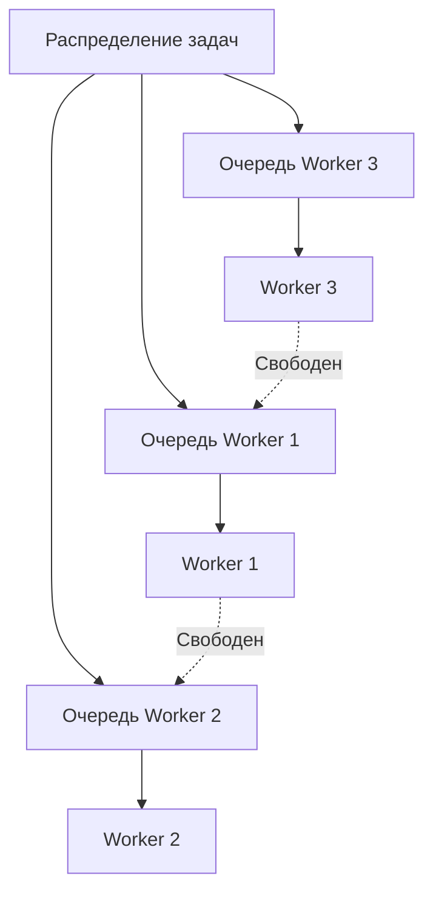
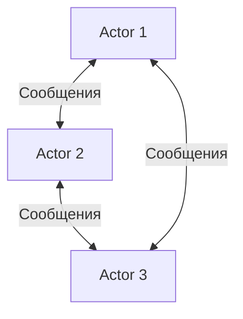
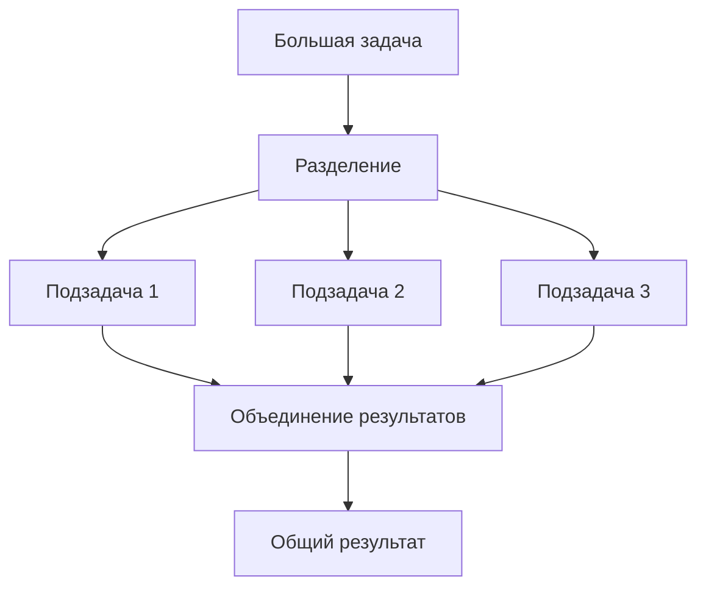
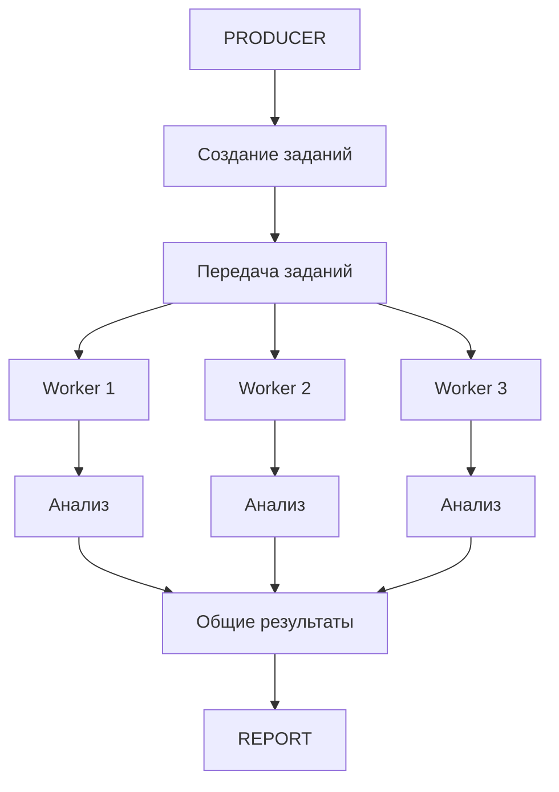
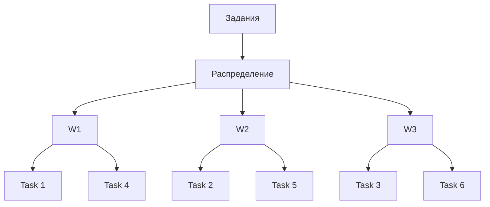
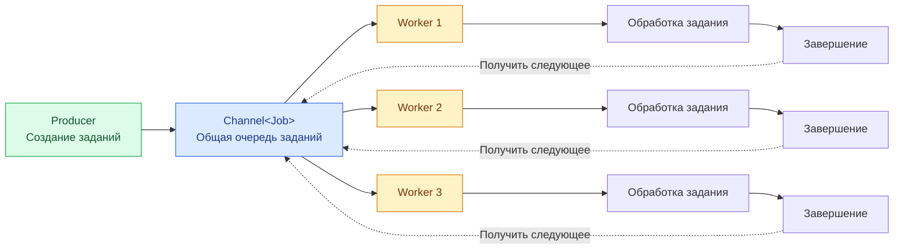
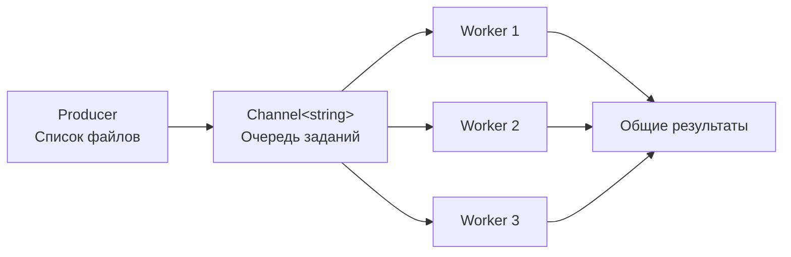

МДК.01.04 «Системное программирование» · Занятие 13 из 18
# Теория

- Producer–Consumer (Производитель–Потребитель)
- Fork–Join (Разделение и объединение)
- Pipeline (Конвейерная обработка)
- MapReduce
- Task Graph (Граф зависимостей задач)
- Work Stealing (Кража заданий)
- Actor Model (Модель акторов)

## MapReduce

Пример: компиляция проекта.
- Загрузка настроек.
- Компиляция независимых файлов.
- Объединение результатов компиляции.
- Создание итогового приложения.

C#: `Task`, `Task.WhenAll()`, `ContinueWith()`.


## Work Stealing (Кража заданий)
У каждого исполнителя есть собственная очередь задач. Если один исполнитель заканчивает работу, он может забрать задачу из очереди другого исполнителя.

Пример: один исполнитель обработал свои задачи, а другой всё ещё занят большой очередью. Свободный исполнитель может забрать часть чужой работы.

C#: механизм Work Stealing используется внутри `TaskScheduler` и стандартного планировщика задач .NET.


## Actor Model (Модель акторов)

Программа состоит из независимых акторов. Каждый актор имеет собственное состояние и взаимодействует с другими акторами посредством сообщений.

Пример: игровой сервер.
- Актор игрока хранит состояние игрока.
- Актор инвентаря управляет предметами.
- Актор боя отвечает за боевую систему.

C#: `Microsoft Orleans`, `Akka.NET`.
## Fork–Join (Разделение и объединение)

Одна большая задача разделяется на несколько независимых подзадач. Они выполняются параллельно, после чего результаты объединяются.

Пример: обработка большого изображения.
- Разделить изображение на 4 части.
- Каждую часть обработать отдельно.
- Объединить обработанные части.

C#: `Task.WhenAll()`, `Parallel.Invoke()`.


## Pipeline (Конвейерная обработка)

Задача проходит несколько последовательных этапов. Каждый этап может выполняться независимо от остальных и обрабатывать собственные данные.


Пример: обработка загруженных документов.
1. Загрузка файла.
2. Проверка формата.
3. Извлечение текста.
4. Анализ содержимого.
5. Сохранение результата.

Пока один документ сохраняется, другой может анализироваться, а третий загружаться.

C#: `Channel<T>`, `Task`.

## Producer/Consumer

архитектурный шаблон, в котором одна часть программы создаёт задания, а другая часть получает и обрабатывает их.

Представим приложение, которое должно обработать 1000 текстовых файлов.

Для каждого файла необходимо:
1. Прочитать содержимое.
2. Посчитать количество строк.
3. Посчитать количество слов.
4. Посчитать количество символов.
5. Сохранить результат.

Можно организовать обработку следующим образом:
- производитель получает список файлов;
- формирует задания;
- задания передаются обработчикам;
- несколько обработчиков независимо выполняют работу;
- результаты собираются в общем хранилище.

Общая схема:


Пример: сервер получает запросы от клиентов и передаёт их обработчикам.

C#: `Channel<T>`, `BlockingCollection<T>`, `ConcurrentQueue<T>`.

**Пример использования в реальных приложениях:**
- веб-сервер получает запросы и передаёт их обработчикам;
- приложение обрабатывает изображения в фоновом режиме;
- система отправляет электронные письма через очередь;
- сервер загружает файлы и передаёт их на проверку;
- игровая система распределяет события между обработчиками.

#### Почему производитель не должен самостоятельно определять, какой именно обработчик получит конкретное задание?
```spoiler
Производитель отвечает за создание заданий, а обработчики - за выполнение. Разделение ответственности упрощает архитектуру и позволяет независимо изменять количество исполнителей.
```
## Worker Pool(пул исполнителей)

это набор независимых исполнителей, которые выполняют поступающие задания.

Например, у нас есть три обработчика:



Пример: сервер обрабатывает 1000 запросов, используя ограниченное количество работников.

C#: `Task.Run()`, `Parallel.ForEachAsync()`, `Channel<T>`.

Когда обработчик заканчивает выполнение задания, он может получить следующее. Заранее необязательно назначать каждому обработчику одинаковое количество заданий.

Например:

| Обработчик | Задание | Время |
| ---------- | ------- | ----- |
| Worker 1   | File1   | 1 сек |
| Worker 2   | File2   | 5 сек |
| Worker 3   | File3   | 2 сек |

Worker 1 завершит работу быстрее и сможет приступить к следующему заданию. Таким образом, распределение нагрузки происходит с учётом фактической занятости исполнителей.
В C# можно создавать несколько независимых асинхронных обработчиков:

```cs
int workerCount = 3;

Task[] workers = Enumerable // создаёт последовательность идентификаторов
    .Range(1, workerCount)
    .Select(id => WorkerAsync(id)) // запускает обработчик для каждого идентификатора
    .ToArray(); // сохраняет задачи

await Task.WhenAll(workers); // ожидает завершения всех обработчиков
```

#### Что произойдёт, если один обработчик выполняет задание 15 секунд, а другой - 1 секунду?
```spoiler
Второй обработчик быстрее освободится и сможет приступить к следующему заданию.
```
## Статическое распределение

Задания заранее распределяются между исполнителями.

Например, имеется 12 файлов и 3 Worker:
- Worker 1 получает файлы 1–4;
- Worker 2 получает файлы 5–8;
- Worker 3 получает файлы 9–12.

Проблема: файлы могут иметь разный размер и время обработки. Один Worker может закончить быстро, а другой ещё долго работать.

## Динамическое распределение
Все задания помещаются в общую очередь. Свободный Worker самостоятельно получает следующее доступное задание.

Принцип динамического распределения



### Как происходит передача задания свободному Worker

Механизм состоит из нескольких шагов:
1. Producer записывает задание в `Channel<T>`.
2. Свободный Worker ожидает появления задания через `ReadAllAsync()`.
3. Когда задание появляется, один из ожидающих Worker получает его.
4. Worker выполняет обработку.
5. После завершения обработки Worker возвращается к ожиданию следующего задания.
6. Если очередь пуста, Worker асинхронно ожидает поступления новых данных.

Важный момент: не требуется отдельно проверять, свободен ли Worker. Сам механизм чтения из канала обеспечивает распределение элементов между потребителями.

## Конкурентный сбор результатов

Несколько обработчиков могут одновременно завершать задания. Поэтому необходимо правильно организовать сбор результатов.

```cs
using System.Collections.Concurrent;

// использование обычного списка не гарантирует безопасность одновременной записи из нескольких потоков.
var resultsUnsafe = new List<string>();


// использование потокобезопасной коллекции:
// позволяет нескольким исполнителям безопасно добавлять элементы
// коллекция не гарантирует сохранение исходного порядка
var resultsSafe = new ConcurrentBag<string>();


// При формировании отчёта можно использовать сортировку:
var sortedResults = resultsSafe
    .OrderBy(x => x)
    .ToList();
```

#### Почему нельзя рассчитывать, что результаты поступят в том же порядке, в котором были созданы задания?
```spoiler
продолжительность обработки заданий различается, поэтому быстрее завершившиеся операции могут записать результаты раньше.
```
## Ограничение нагрузки

Представим ситуацию:
- производитель создаёт 100 заданий в секунду;
- один обработчик выполняет 20 заданий в секунду;
- обработчиков три;
- общая производительность составляет 60 заданий в секунду.

Возникает проблема: система получает больше заданий, чем успевает выполнять.
Если не контролировать поступление заданий, они могут накапливаться и занимать оперативную память.

Основные параметры системы:

|Параметр|Назначение|
|---|---|
|Количество производителей|Скорость создания заданий|
|Количество обработчиков|Количество одновременно работающих исполнителей|
|Размер ожидающих заданий|Объём накопленной работы|


#### Почему увеличение количества обработчиков не всегда решает проблему производительности?
```spoiler
дополнительные исполнители также используют процессорное время, память и другие ресурсы. Кроме того, некоторые операции могут ограничиваться пропускной способностью диска или сети.
```

### Что такое `Channel<T>`

механизм из пространства имён `System.Threading.Channels`, предназначенный для асинхронной передачи данных между производителями (Producer) и потребителями (Consumer).

Канал представляет собой своеобразную очередь, в которую один или несколько производителей помещают данные, а один или несколько потребителей извлекают их для обработки.
Основное отличие от обычной коллекции заключается в том, что операции записи и чтения могут выполняться асинхронно.

Общая схема взаимодействия:



Производитель не обязан знать, какой именно Worker обработает задание.
Потребитель не обязан знать, откуда поступило задание.
Канал выступает посредником между ними.

Для работы с каналами используются два основных интерфейса:

- `ChannelWriter<T>` - запись данных;
- `ChannelReader<T>` - чтение данных.

Основные методы:

| Метод               | Назначение                                         |
| ------------------- | -------------------------------------------------- |
| `WriteAsync()`      | Асинхронная запись элемента                        |
| `TryWrite()`        | Попытка записать элемент без ожидания              |
| `ReadAsync()`       | Асинхронное получение одного элемента              |
| `TryRead()`         | Попытка получить элемент без ожидания              |
| `ReadAllAsync()`    | Асинхронное последовательное чтение всех элементов |
| `WaitToReadAsync()` | Ожидание появления доступных данных                |
| `TryComplete()`     | Завершение записи в канал                          |

Особое внимание следует уделить `ReadAllAsync()`.

Он позволяет использовать асинхронный цикл:

```csharp
// Цикл продолжает работу, пока в канале появляются данные. После завершения записи и обработки оставшихся элементов он заканчивается.
await foreach (var item in reader.ReadAllAsync())
{
    Console.WriteLine(item);
}
```

### Создание канала

**Неограниченный канал:**

```csharp
var channel = Channel.CreateUnbounded<string>();
```

В него можно записывать данные без установленного ограничения вместимости.
Недостаток: при слишком быстром производителе и медленных потребителях очередь может неограниченно увеличиваться, потребляя оперативную память.

**Ограниченный канал:**

```csharp
var channel = Channel.CreateBounded<string>(10);
```

Вместимость канала составляет 10 элементов.
Если канал заполнен, следующая операция `WriteAsync()` будет ожидать освобождения места.
Это называется **Backpressure (обратное давление)**.
Производитель автоматически замедляется, если потребители не успевают обрабатывать поступающие задания.

### Настройка ограниченного канала

Можно дополнительно настроить поведение канала:

```csharp
var options = new BoundedChannelOptions(10)
{
	// FullMode определяет поведение при заполнении канала
	
	// Другие режимы заполнения:
	// Wait - Ожидание освобождения места
	// DropNewest - Удаление самого нового элемента из очереди
	// DropOldest - Удаление самого старого элемента
	// DropWrite - Отбрасывание нового записываемого элемента
    FullMode = BoundedChannelFullMode.Wait,
    SingleWriter = true, // указывает, что предполагается один производитель
    SingleReader = false // указывает, что предполагается не один потребитель
};

var channel = Channel.CreateBounded<string>(options);
```

Для анализатора файлов обычно подходит `Wait`, поскольку терять задания нельзя.

### Закрытие канала

После передачи всех заданий производитель должен сообщить, что новых элементов больше не будет. Для этого используется:

```cs
writer.TryComplete();
```

После завершения записи потребители дочитывают оставшиеся элементы и завершают работу. 
**Завершение канала не означает немедленное удаление данных**. 
Уже записанные элементы остаются доступными для чтения.
Если производитель не завершит канал, потребители, ожидающие новые задания, могут продолжать ожидание.

### `Channel<T>` и `Task` - в чём разница?

Эти механизмы решают разные задачи.

| Механизм             | Назначение                                                |
| -------------------- | --------------------------------------------------------- |
| `Task`               | Представляет асинхронную операцию                         |
| `Channel<T>`         | Передаёт данные между производителями и потребителями     |
| `SemaphoreSlim`      | Ограничивает количество одновременно выполняемых операций |
| `ConcurrentQueue<T>` | Обеспечивает потокобезопасную очередь                     |
`Channel<T>` не создаёт дополнительные потоки самостоятельно. Он организует передачу данных, а выполнение обработки обеспечивается асинхронными задачами.

---

# Практика

Создадим консольное приложение для обработки множества текстовых файлов.
Главная задача проекта - реализовать архитектуру, в которой создание заданий, их обработка и сбор результатов разделены между независимыми компонентами.

Структура проекта:

```
FileProcessingPipeline/
├── FileProcessingPipeline.csproj
├── Program.cs
│
├── Models/
│   ├── FileTask.cs
│   ├── FileAnalysisResult.cs
│   ├── FileProcessingError.cs
│   └── AnalysisReport.cs
│
├── Services/
│   ├── TextCounter.cs
│   ├── FileAnalyzer.cs
│   ├── SequentialProcessor.cs
│   ├── PipelineProcessor.cs
│   └── ReportService.cs
│
└── Data/
    ├── file1.txt
    ├── file2.txt
    ├── file3.txt
    └── file4.txt
```


## `Models/FileTask.cs`
```cs
namespace FileProcessingPipeline.Models;

// Каждое задание будет содержать идентификатор и путь к файлу
// Это позволяет передавать между компонентами самостоятельные объекты заданий, а не просто строки.
public sealed record FileTask(
    int Id,
    string FilePath
);
```

## `Models/FileAnalysisResult.cs`
```cs
namespace FileProcessingPipeline.Models;

// Дополнительное свойство `WorkerId` позволяет определить, какой исполнитель обработал файл.
public sealed record FileAnalysisResult(
    int TaskId,
    string FileName,
    int Lines,
    int Words,
    long Characters,
    long ProcessingTimeMs,
    int WorkerId
);
```

## `Models/FileProcessingError.cs`
```cs
namespace FileProcessingPipeline.Models;

public sealed record FileProcessingError(
    int TaskId,
    string FileName,
    string ErrorType,
    string Message
);
```

## `Models/AnalysisReport.cs`
```cs
namespace FileProcessingPipeline.Models;

public sealed class AnalysisReport
{
    public string Mode { get; init; } = "";
    public int TotalFiles { get; init; }
    public int SuccessfulFiles { get; init; }
    public int FailedFiles { get; init; }
    public int WorkerCount { get; init; }
    public long TotalLines { get; init; }
    public long TotalWords { get; init; }
    public long TotalCharacters { get; init; }
    public long ProcessingTimeMs { get; init; }
    public List<FileAnalysisResult> Results { get; init; } = [];
    public List<FileProcessingError> Errors { get; init; } = [];
}
```

## `Services/TextCounter.cs`
```cs
namespace FileProcessingPipeline.Services;

// Задача - подсчитать количество строк, слов и символов
// Правила:
// - пустой файл содержит 0 строк;
// - `Hello\n` содержит 1 строку;
// - `слово` является последовательностью символов, разделённая пробельными символами;
// - символы считаются через `string.Length`.
public static class TextCounter
{
    public static (int Lines, int Words, long Characters)
        Count(string text)
    {
        ArgumentNullException.ThrowIfNull(text);
        int lines = 0;
        if (!string.IsNullOrEmpty(text))
        {
            foreach (char c in text)
            {
                if (c == '\n')
                {
                    lines++;
                }
            }

            if (text[^1] != '\n')
            {
                lines++;
            }
        }

        int words = text
            .Split(
                (char[]?)null,
                StringSplitOptions.RemoveEmptyEntries)
            .Length;

        long characters = text.Length;

        return (lines, words, characters);
    }
}
```

## `Services/FileAnalyzer.cs`
```cs
using System.Diagnostics;
using FileProcessingPipeline.Models;

namespace FileProcessingPipeline.Services;
// Класс отвечает исключительно за анализ одного файла.
// ничего не знает о количестве исполнителей и распределении заданий
// Это разделение ответственности: анализ одного файла и организация параллельной работы - разные задачи
public static class FileAnalyzer
{
    public static async Task<FileAnalysisResult> AnalyzeAsync(
        FileTask task,
        int workerId)
    {
        var stopwatch = Stopwatch.StartNew();

        string content = await File.ReadAllTextAsync(
            task.FilePath);

        var statistics = TextCounter.Count(content);

        stopwatch.Stop();

        return new FileAnalysisResult(
            TaskId: task.Id,
            FileName: Path.GetFileName(task.FilePath),
            Lines: statistics.Lines,
            Words: statistics.Words,
            Characters: statistics.Characters,
            ProcessingTimeMs: stopwatch.ElapsedMilliseconds,
            WorkerId: workerId
        );
    }
}
```

## `Services/SequentialProcessor.cs`
```cs
using System.Diagnostics;
using FileProcessingPipeline.Models;

namespace FileProcessingPipeline.Services;
// Последовательная реализация понадобится для сравнения с параллельной.
public static class SequentialProcessor
{
    public static async Task<AnalysisReport> ProcessAsync(
        IEnumerable<FileTask> tasks)
    {
        var stopwatch = Stopwatch.StartNew();

        var results = new List<FileAnalysisResult>();
        var errors = new List<FileProcessingError>();

        var taskList = tasks.ToList();

        foreach (var task in taskList)
        {
            try
            {
                var result = await FileAnalyzer.AnalyzeAsync(
                    task,
                    1);

                results.Add(result);

                Console.WriteLine(
                    $"[OK] {result.FileName}");
            }
            catch (IOException ex)
            {
                errors.Add(new FileProcessingError(
                    task.Id,
                    Path.GetFileName(task.FilePath),
                    nameof(IOException),
                    ex.Message));
            }
            catch (UnauthorizedAccessException ex)
            {
                errors.Add(new FileProcessingError(
                    task.Id,
                    Path.GetFileName(task.FilePath),
                    nameof(UnauthorizedAccessException),
                    ex.Message));
            }
        }

        stopwatch.Stop();

        return ReportService.Create(
            "Sequential",
            taskList.Count,
            results,
            errors,
            1,
            stopwatch.ElapsedMilliseconds);
    }
}
```

## `Services/PipelineProcessor.cs`

```cs
using System.Collections.Concurrent;
using FileProcessingPipeline.Models;

namespace FileProcessingPipeline.Services;
// Это центральный класс практического проекта.
// Здесь мы разделяем три обязанности:
// 1. Создание заданий.
// 2. Выполнение заданий независимыми обработчиками.
// 3. Сбор результатов.
public static class PipelineProcessor
{
    public static async Task<AnalysisReport> ProcessAsync(
        IEnumerable<FileTask> tasks,
        int workerCount)
    {
        ArgumentNullException.ThrowIfNull(tasks);

        if (workerCount < 1)
        {
            throw new ArgumentOutOfRangeException(
                nameof(workerCount));
		}
        
        var taskList = tasks.ToList();

        var results = new ConcurrentBag<FileAnalysisResult>();

        var errors = new ConcurrentBag<FileProcessingError>();

        // TODO:
        // Добавить механизм передачи заданий
        // между производителем и обработчиками.

        // TODO:
        // Запустить workerCount обработчиков.

        // TODO:
        // Организовать получение и обработку заданий.

        // TODO:
        // Дождаться завершения всех обработчиков.

        // TODO:
        // Измерить общее время выполнения.

        return ReportService.Create(
            $"Pipeline ({workerCount} workers)",
            taskList.Count,
            results.ToList(),
            errors.ToList(),
            workerCount,
            0);
    }
	// уже реализует обработку одного задания
	// Но пока не определено, откуда обработчик будет получать следующее задание
    private static async Task WorkerAsync(
        int workerId,
        FileTask task,
        ConcurrentBag<FileAnalysisResult> results,
        ConcurrentBag<FileProcessingError> errors)
    {
        try
        {
            Console.WriteLine(
                $"[WORKER {workerId}] Начал: {task.FilePath}");

            var result = await FileAnalyzer.AnalyzeAsync(
                task,
                workerId);

            results.Add(result);

            Console.WriteLine(
                $"[WORKER {workerId}] Завершил: {result.FileName}");
        }
        catch (IOException ex)
        {
            errors.Add(new FileProcessingError(
                task.Id,
                Path.GetFileName(task.FilePath),
                nameof(IOException),
                ex.Message));
        }
        catch (UnauthorizedAccessException ex)
        {
            errors.Add(new FileProcessingError(
                task.Id,
                Path.GetFileName(task.FilePath),
                nameof(UnauthorizedAccessException),
                ex.Message));
        }
    }
}
```

## `Services/ReportService.cs`
```cs
using FileProcessingPipeline.Models;

namespace FileProcessingPipeline.Services;

public static class ReportService
{
    public static AnalysisReport Create(
        string mode,
        int totalFiles,
        List<FileAnalysisResult> results,
        List<FileProcessingError> errors,
        int workerCount,
        long processingTimeMs)
    {
        return new AnalysisReport
        {
            Mode = mode,
            TotalFiles = totalFiles,
            SuccessfulFiles = results.Count,
            FailedFiles = errors.Count,
            WorkerCount = workerCount,
            TotalLines = results.Sum(x => (long)x.Lines),
            TotalWords = results.Sum(x => (long)x.Words),
            TotalCharacters = results.Sum(x => x.Characters),
            ProcessingTimeMs = processingTimeMs,
            Results = results
                .OrderBy(x => x.FileName)
                .ToList(),

            Errors = errors
                .OrderBy(x => x.FileName)
                .ToList()
        };
    }
}
```

## `Program.cs`
```cs
using System.Text.Json;
using FileProcessingPipeline.Models;
using FileProcessingPipeline.Services;

namespace FileProcessingPipeline;

internal class Program
{
    private static async Task Main()
    {
        Console.WriteLine("================================");
        Console.WriteLine("     FILE PROCESSING PIPELINE");
        Console.WriteLine("================================");

        string dataDirectory = Path.Combine(
            AppContext.BaseDirectory,
            "Data");

        Directory.CreateDirectory(dataDirectory);

        string[] paths = Directory.GetFiles(
            dataDirectory,
            "*.txt");

        if (paths.Length == 0)
        {
            Console.WriteLine("Нет файлов для обработки.");
            return;
        }

        var tasks = paths
            .Select((path, index) =>
                new FileTask(index + 1, path))
            .ToList();

        Console.WriteLine(
            $"Найдено файлов: {tasks.Count}");

        Console.WriteLine();
        Console.WriteLine("1. Последовательная обработка");
        Console.WriteLine("2. Параллельная обработка");

        Console.Write("Выберите режим: ");

        string? choice = Console.ReadLine();

        AnalysisReport report;

        switch (choice)
        {
            case "1":

                report = await SequentialProcessor.ProcessAsync(
                    tasks);

                break;

            case "2":

                Console.Write("Количество обработчиков: ");

                if (!int.TryParse(
                        Console.ReadLine(),
                        out int workerCount) ||
                    workerCount < 1)
                {
                    Console.WriteLine("Некорректное значение.");
                    return;
                }

                report = await PipelineProcessor.ProcessAsync(
                    tasks,
                    workerCount);

                break;

            default:

                Console.WriteLine("Неизвестный режим.");
                return;
        }

        PrintReport(report);

        await SaveReportAsync(report);
    }

    private static void PrintReport(AnalysisReport report)
    {
        Console.WriteLine();
        Console.WriteLine("========== ОТЧЁТ ==========");
        Console.WriteLine($"Режим: {report.Mode}");
        Console.WriteLine($"Всего файлов: {report.TotalFiles}");
        Console.WriteLine($"Успешно: {report.SuccessfulFiles}");
        Console.WriteLine($"Ошибок: {report.FailedFiles}");
        Console.WriteLine($"Обработчиков: {report.WorkerCount}");
        Console.WriteLine($"Строк: {report.TotalLines}");
        Console.WriteLine($"Слов: {report.TotalWords}");
        Console.WriteLine($"Символов: {report.TotalCharacters}");
        Console.WriteLine($"Время: {report.ProcessingTimeMs} мс");
        Console.WriteLine();
        Console.WriteLine("РЕЗУЛЬТАТЫ:");

        foreach (var result in report.Results)
        {
            Console.WriteLine(
                $"{result.FileName} | " +
                $"Worker: {result.WorkerId} | " +
                $"Строк: {result.Lines} | " +
                $"Слов: {result.Words}");
        }

        if (report.Errors.Count > 0)
        {
            Console.WriteLine();
            Console.WriteLine("ОШИБКИ:");

            foreach (var error in report.Errors)
            {
                Console.WriteLine(
                    $"{error.FileName}: {error.ErrorType} - {error.Message}");
            }
        }
    }

    private static async Task SaveReportAsync(
        AnalysisReport report)
    {
        var options = new JsonSerializerOptions
        {
            WriteIndented = true
        };
        string json = JsonSerializer.Serialize(
            report,
            options);
        string path = Path.Combine(
            AppContext.BaseDirectory,
            "report.json");

        await File.WriteAllTextAsync(path, json);

        Console.WriteLine();
        Console.WriteLine($"Отчёт сохранён: {path}");
    }
}
```

**Примечание:** до добавления механизма передачи заданий метод `PipelineProcessor.ProcessAsync` является незавершённой частью проекта. Последовательный режим уже можно запускать и проверять. Параллельный режим будет завершён после добавления отмеченного материала.

## Настройка проекта

`FileProcessingPipeline.csproj`
```cs
<Project Sdk="Microsoft.NET.Sdk">

  <PropertyGroup>
    <OutputType>Exe</OutputType>
    <TargetFramework>net9.0</TargetFramework>
    <ImplicitUsings>enable</ImplicitUsings>
    <Nullable>enable</Nullable>
  </PropertyGroup>

  <ItemGroup>
    <Content Include="Data\**\*">
      <CopyToOutputDirectory>PreserveNewest</CopyToOutputDirectory>
    </Content>
  </ItemGroup>

</Project>
```

Создать тестовые файлы.

`Data/file1.txt`

```
Hello world!
C# is great.
Parallel programming is interesting.
```

`Data/file2.txt`

```
One two three.
Four five six.
Seven eight nine.
```

`Data/file3.txt`

```
Task
Thread
Parallel
Async
Await
```

`Data/file4.txt`

```
Это пример русского текста.
Параллельная обработка файлов.
Проверяем количество слов и строк.
```

---

# П1

**Основная задача:** научиться разделять создание заданий, обработку и сбор результатов.

### Задание 1. Создать модель задания

Создать `FileTask`.

```cs
public sealed record FileTask(
    int Id,
    string FilePath
);
```

Требования:
1. Каждое задание должно иметь уникальный ID.
2. Должен храниться путь к файлу.
3. Создать коллекцию из 10 заданий.

### Задание 2. Реализовать анализ одного задания

Использовать `FileAnalyzer.AnalyzeAsync`.

Программа должна:
1. Прочитать файл.
2. Подсчитать статистику.
3. Сформировать результат.
4. Указать ID обработчика.

### Задание 3. Реализовать независимого обработчика

Создать метод:

```cs
private static async Task WorkerAsync(
    int workerId,
    FileTask task)
{
    // TODO 1:
    // Вывести ID обработчика.

    // TODO 2:
    // Выполнить анализ файла.

    // TODO 3:
    // Вывести результат.
}
```

На этом этапе обработчик получает задание напрямую через аргумент.
Это позволяет сначала проверить его работу независимо от механизма распределения заданий.

### Задание 4. Запустить несколько обработчиков

Создать массив задач:

```cs
Task[] workers = Enumerable
    .Range(1, 3)
    .Select(id => WorkerAsync(id, task))
    .ToArray();
```

Здесь для проверки передаётся одно и то же задание.

Дождаться выполнения:

```cs
await Task.WhenAll(workers);
```

### Задание 5. Реализовать сбор результатов

Создать:

```cs
var results = new ConcurrentBag<FileAnalysisResult>();
```

Добавить результаты из обработчиков.

Проверить:
- результаты не теряются;
- каждый обработчик записывает свой результат;
- можно определить исполнителя;
- результаты можно отсортировать.

### Задание 6. Самостоятельно организовать распределение разных заданий.

---

# П2

**Основная задача:** научиться анализировать поведение параллельной системы и обрабатывать ошибки.

### Задание 1. Изменить количество обработчиков

Добавить возможность выбора количества исполнителей.

Проверить четыре конфигурации:

|Количество обработчиков|
|---|
|1|
|2|
|4|
|8|

Для каждого варианта записать:
- время выполнения;
- количество обработанных файлов;
- количество ошибок;
- распределение заданий.

### Задание 2. Обработать ошибочные задания

Создать ситуацию, когда один из файлов невозможно прочитать.

```cs
var tasks = new List<FileTask>
{
    new(1, "Data/file1.txt"),
    new(2, "Data/file2.txt"),
    new(3, "Data/missing.txt"),
    new(4, "Data/file3.txt"),
    new(5, "Data/file4.txt")
};
```

Требования:
1. Ошибка должна быть перехвачена.
2. Информация должна попасть в `Errors`.
3. Остальные задания должны продолжить обрабатываться.
4. Программа не должна завершаться аварийно.
5. В отчёте должно быть правильное количество успешных операций и ошибок.

Запрещается использовать:

```cs
catch {}
```

### Задание 3. Реализовать статистику исполнителей

Добавить информацию о том, сколько заданий выполнил каждый обработчик.

Пример:

```
========== СТАТИСТИКА WORKERS ==========

Worker 1: 7 заданий
Worker 2: 5 заданий
Worker 3: 8 заданий

Всего обработано: 20

=======================================
```

Подсказка:

```cs
var statistics = results
    .GroupBy(x => x.WorkerId)
    .Select(group => new
    {
        WorkerId = group.Key,
        Count = group.Count()
    });
```

### Задание 4. Сравнить производительность

Сравнить последовательную и параллельную обработку.

|Режим|Обработчики|Время|
|---|---|---|
|Sequential|1|...|
|Parallel|1|...|
|Parallel|2|...|
|Parallel|4|...|
|Parallel|8|...|

Ответить на вопросы:
1. Почему параллельная обработка с одним исполнителем может быть медленнее последовательной?
2. Почему увеличение количества обработчиков не всегда ускоряет программу?
3. Как объём данных влияет на производительность?
4. Почему важно контролировать количество одновременно выполняемых операций?

### Задание 5. Анализ архитектуры

Представить, что вместо файлов приложение должно обрабатывать 10 000 изображений.

Необходимо определить:
- кто будет создавать задания;
- что будет содержать задание;
- какие операции выполняет обработчик;
- какие результаты необходимо сохранять;
- как регистрировать ошибки;
- как контролировать нагрузку.

Нарисовать архитектурную схему.

---

# 5. Проверка корректности и типичные ошибки

|Ошибка|Почему неправильно|Как исправить|
|---|---|---|
|Вся логика находится в одном методе|Сложно поддерживать и тестировать|Разделить компоненты|
|Производитель сам выполняет обработку|Смешиваются обязанности|Отделить создание и выполнение заданий|
|Используется обычный `List<T>` для конкурентной записи|Возможна гонка данных|Использовать потокобезопасную коллекцию|
|Не ожидается `Task.WhenAll()`|Не гарантируется завершение всех обработчиков|Дожидаться всех задач|
|Ошибка одного задания останавливает всю систему|Остальные задания не обрабатываются|Обрабатывать ошибки на уровне задания|
|Слишком много исполнителей|Растёт нагрузка на систему|Подбирать количество экспериментально|
|Не учитывается продолжительность заданий|Возможна неравномерная нагрузка|Использовать динамическое распределение|
|Сравнение только по времени|Не проверяется корректность|Сначала сравнить результаты|

# Контрольные вопросы

1. Что такое Producer–Consumer?
2. Какие обязанности выполняет производитель?
3. Для чего нужны потребители?
4. Что такое Worker Pool?
5. Почему обработчики должны быть независимыми?
6. Почему задания могут распределяться неравномерно?
7. Почему необходима потокобезопасная коллекция результатов?
8. Почему результаты могут поступать не в исходном порядке?
9. Почему увеличение количества обработчиков не всегда ускоряет приложение?
10. Для чего используется `Task.WhenAll()`?
11. Что произойдёт, если один обработчик завершится с ошибкой?
12. Где в реальных приложениях можно использовать такую архитектуру?

---

# Домашнее задание

**Задача: расширить FileProcessingPipeline и реализовать сохранение статистики работы системы.**

### Задание 1. Сохранение отчёта в JSON

Сохранить итоговую статистику в `report.json`.

Использовать:

```cs
using System.Text.Json;

var options = new JsonSerializerOptions
{
    WriteIndented = true
};

string json = JsonSerializer.Serialize(
    report,
    options);

await File.WriteAllTextAsync(
    "report.json",
    json);
```

### Задание 2. Добавить статистику исполнителей

В JSON должны присутствовать:
- общее количество обработчиков;
- количество успешно обработанных файлов;
- количество ошибок;
- количество заданий каждого обработчика;
- общее время обработки.

### Задание 3. Провести эксперимент

Провести обработку одного набора файлов с использованием:
- 1 обработчика;
- 2 обработчиков;
- 4 обработчиков;
- 8 обработчиков.

Для каждого варианта сохранить время выполнения и распределение заданий.

### Задание 4. Ответить на вопросы
1. Почему архитектура Producer–Consumer удобна при обработке большого количества заданий?
2. Почему важно разделять создание и обработку заданий?
3. Почему нельзя просто создать 1000 обработчиков?
4. Почему разные задания могут занимать разное время?
5. В каких реальных проектах можно использовать такую архитектуру?

### Критерии оценки

|Критерий|Баллы|
|---|---|
|Реализована архитектура независимых обработчиков|2|
|Корректно работает распределение заданий|2|
|Реализована обработка ошибок|1|
|Отчёт сохраняется в JSON|2|
|Проведено сравнение конфигураций|1|
|Даны ответы на вопросы|2|
|**Всего**|**10**|

---

# Подготовка преподавателя

Перед занятием подготовить:

|Набор|Количество|Назначение|
|---|---|---|
|Маленькие файлы|5–10|Проверка корректности|
|Средние файлы|50–100|Демонстрация распределения нагрузки|
|Большие файлы|500–1000|Эксперименты с производительностью|

Дополнительно:

1. Один несуществующий файл для проверки ошибок.
2. Пример задания с длительной обработкой.
3. Несколько конфигураций количества обработчиков.
4. Схему взаимодействия производителя и потребителей.

### Проверка перед занятием

- Проект собирается через `dotnet build`.
- Последовательная обработка работает.
- Модель задания реализована.
- Анализ одного файла работает.
- Метод обработчика работает независимо.
- Сбор результатов работает.
- Обработка ошибок реализована.
- Подготовлены места для добавления механизма передачи заданий.

---

# Методические рекомендации

## На что обратить внимание

Главная задача занятия - сформировать у студентов понимание того, что параллельное приложение необходимо проектировать как систему взаимодействующих компонентов.

Важно объяснить различия:

|Компонент|Ответственность|
|---|---|
|Producer|Создание заданий|
|Worker|Выполнение заданий|
|Consumer|Получение заданий для обработки|
|Result Collector|Сбор результатов|
|Report Service|Формирование итоговой статистики|

Необходимо подчеркнуть, что создание нескольких `Task` ещё не означает наличие полноценной архитектуры параллельной обработки.

Нужно продумать взаимодействие компонентов, распределение нагрузки и обработку ошибок.

## Связь с предыдущими занятиями

| Предыдущие темы        | Занятие 13                                   |
| ---------------------- | -------------------------------------------- |
| Многопоточность        | Независимые исполнители                      |
| `Task` и `async/await` | Асинхронные обработчики                      |
| `ThreadPool`           | Организация пула исполнителей                |
| `lock` и синхронизация | Потокобезопасное взаимодействие              |
| `Interlocked`          | Конкурентный доступ к общим данным           |
| `Parallel.For`         | Архитектура распределённой обработки заданий |
