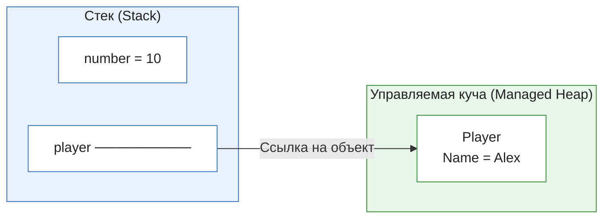
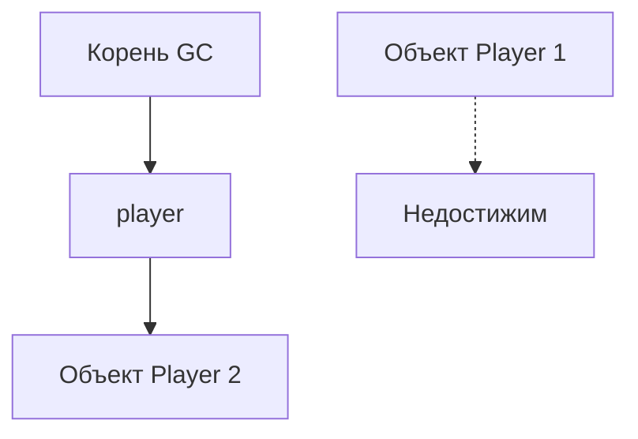

# Теория

## Стек и куча

область памяти, используемая для хранения данных вызовов методов: локальных переменных, параметров и служебной информации вызовов.
Управляемой кучей (Managed Heap) называют область памяти, в которой .NET размещает объекты, временем жизни которых управляет CLR и Garbage Collector.

Упрощённый пример:
```cs
int number = 10;

var player = new Player
{
    Name = "Alex"
};
```

Здесь:
- `number` - локальная переменная со значением типа `int`;
- `player` - локальная переменная-ссылка;
- сам объект `Player` размещается в управляемой куче.

Упрощённая схема:


Не все локальные переменные обязательно физически хранятся в стеке: JIT-компилятор может использовать регистры, оптимизировать переменные и менять их размещение.
#### что произойдёт с объектом `Player`, если переменная `player` перестанет на него ссылаться?
```spoiler
если на объект больше нет достижимых ссылок из корней GC, он становится кандидатом на сборку мусора.
```
## Достижимость объектов(Reachability)
возможность получить доступ к объекту от специальных исходных точек, называемых корнями GC.

К корням относятся:
- активные ссылки из стеков потоков;
- статические поля;
- некоторые внутренние ссылки среды выполнения.

Пример:
```cs
var player = new Player();
player = new Player();
```

После второй строки первая созданная сущность больше не доступна через переменную `player`.
Если на неё нет других достижимых ссылок, GC сможет освободить занимаемую ею управляемую память.
Важно: недостижимый объект не обязательно удаляется немедленно. GC запускается по своим алгоритмам и в подходящий момент.

Схема:


#### если объект больше не используется в коде, означает ли что GC немедленно освободит его память?
```spoiler
Нет. Возможность сборки и фактическое выполнение сборки это разные события.
```
## Поколения Garbage Collector
это механизм CLR, который автоматически определяет недостижимые объекты и освобождает занимаемую ими управляемую память.

В .NET используется поколенческая модель.
Основная идея: многие объекты живут недолго. Поэтому GC чаще проверяет молодое поколение, а более старые поколения собирает реже.

| Поколение | Назначение                                    |
| --------- | --------------------------------------------- |
| Gen 0     | Новые объекты, которые ещё не пережили сборку |
| Gen 1     | Промежуточное поколение                       |
| Gen 2     | Долгоживущие объекты                          |
```cs
// Пример:
// Оба объекта могут изначально попасть в Gen 0. Размер объекта сам по себе не означает, что он обязательно окажется в Gen 2.
var first = new byte[1024];
var second = new byte[1024 * 1024]; // 1048576

// Проверить поколение объекта можно через:
Console.WriteLine(
	GC.GetGeneration(first));

// А количество сборок по поколениям:
Console.WriteLine(
    GC.CollectionCount(0));

Console.WriteLine(
    GC.CollectionCount(1));

Console.WriteLine(
    GC.CollectionCount(2));
```

#### Почему GC не проверяет все объекты при каждом выделении памяти?
```spoiler
Потому что это создавало бы лишние затраты. Поколенческая модель позволяет эффективнее работать с объектами, которые часто создаются и быстро становятся ненужными.
```
## Управляемая память и внешние ресурсы
Называется память объектов .NET, освобождением которой занимается GC. Это центральное понятие занятия.
Внешние ресурсы (Unmanaged Resources) - ресурсы, жизненным циклом которых нужно управлять отдельно от обычной управляемой памяти.

Примеры:
- файловые дескрипторы;
- сетевые сокеты;
- системные дескрипторы;
- некоторые ресурсы операционной системы;
- неуправляемая память, выделенная через специальные API.

```cs
// Например:
// Объект `FileStream` находится в управляемой куче, но он владеет системным файловым ресурсом.
// Когда объект перестаёт быть достижимым, GC может позднее обнаружить его и выполнить финализацию, если она предусмотрена. 
// Но это не гарантирует своевременного закрытия файла.
// Поэтому освобождение ресурсов нужно организовывать явно.
var stream = new FileStream(
    "data.txt",
    FileMode.Open);
```
#### Если переменная `stream` перестала использоваться, гарантирует ли GC, что файл немедленно закроется?
```spoiler
Нет. Для этого используется `Dispose()`.
```
## IDisposable и using

IDisposable - интерфейс, определяющий метод `Dispose()`, через который объект освобождает принадлежащие ему ресурсы.

```cs
// Пример:
using var stream = new FileStream(
    "data.txt",
    FileMode.Open);

// Когда выполнение покидает область видимости, `Dispose()` будет вызван автоматически.
// Обычная конструкция:
// `using` особенно важен при исключениях: блок `finally` выполняется и при обычном выходе из блока, и при возникновении исключения.
using (var stream = new FileStream(
    "data.txt",
    FileMode.Open))
{
    // Работа с файлом.
}

// По смыслу она эквивалентна конструкции `try/finally`:
var stream = new FileStream(
    "data.txt",
    FileMode.Open);

try
{
    // Работа с файлом.
}
finally
{
    stream.Dispose();
}
```
#### Что произойдёт, если внутри `using` возникнет исключение?
```spoiler
`Dispose()` всё равно будет вызван.
```
## Почему GC.Collect() не является решением

```cs
// `GC.Collect()` принудительно запрашивает выполнение сборки мусора.
// Но это не универсальный способ освобождения ресурсов.
GC.Collect();
GC.WaitForPendingFinalizers();
```

Причины:
- GC управляет управляемой памятью, а не временем закрытия всех внешних ресурсов.
- Принудительная сборка может ухудшить производительность.
- Она не исправляет неправильное владение ресурсами.
- Она не заменяет `Dispose()`.

Из этого следует что, GC отвечает за управляемую память, а `IDisposable` - за явное освобождение ресурсов.

# Практика

Создадим небольшую систему работы с файлами, в которой можно:

1. Открывать и читать файлы.
2. Сравнить работу с `FileStream` без `using` и с `using`.
3. Проверять освобождение ресурса при исключении.
4. Реализовать собственный класс, который владеет `FileStream`.
5. Проверять, что ресурс освобождается при вызове `Dispose()`.

В качестве дополнительной проверки будем использовать попытку повторного открытия файла с тем же режимом доступа. Однако важно понимать: поведение блокировок файлов зависит от ОС и режима открытия. Поэтому основной критерий правильного освобождения - корректный вызов `Dispose()`, а не только возможность повторно открыть файл.

## Структура проекта

```
ResourceManagementLab/
│
├── ResourceManagementLab.csproj
├── Program.cs
│
├── Models/
│   └── ResourceInfo.cs
│
├── Services/
│   ├── FileReaderWithoutUsing.cs
│   ├── FileReaderWithUsing.cs
│   ├── FileStorage.cs
│   └── MemoryDemo.cs
│
└── Data/
    └── sample.txt
```

### `Services/FileReaderWithoutUsing.cs`
```cs
namespace ResourceManagementLab.Services;

// Начнём с намеренно неправильного варианта.
// Здесь создаются два объекта:
// - `FileStream` - управляет файловым ресурсом;
// - `StreamReader` - читает текст из потока.
// и неправильный вариант в том, что мы не освобождаем ни один из объектов явно.
// eсли во время чтения возникнет исключение, ресурс также не будет закрыт этим методом.
public static class FileReaderWithoutUsing
{
    public static string Read(string filePath)
    {
        var stream = new FileStream(
            filePath,
            FileMode.Open,
            FileAccess.Read);

        var reader = new StreamReader(stream);

        string content = reader.ReadToEnd();

        // Намеренно не вызываем Dispose().
        return content;
    }
}
```

### `Services/FileReaderWithUsing.cs`
```cs
namespace ResourceManagementLab.Services;

// Теперь оба объекта освобождаются автоматически.
// Порядок освобождения обратный порядку создания:
// 1. Сначала `StreamReader`.
// 2. Затем `FileStream`.
public static class FileReaderWithUsing
{
    public static string Read(string filePath)
    {
        using var stream = new FileStream(
            filePath,
            FileMode.Open,
            FileAccess.Read);

		// `StreamReader` владеет переданным потоком по умолчанию, 
		// поэтому в этом примере оба `using` допустимы, хотя закрытие потока происходит дважды. 
		// Повторный вызов `Dispose()` для стандартного `FileStream` безопасен.
        using var reader = new StreamReader(stream);

        return reader.ReadToEnd();
    }
}
```

Можно упростить до:

```cs
// В этом варианте `StreamReader` отвечает за освобождение созданного для него потока.
using var reader = new StreamReader(
    new FileStream(
        filePath,
        FileMode.Open,
        FileAccess.Read));

return reader.ReadToEnd();
```

### `Services/FileReaderWithUsing.cs`
```cs
// Добавим отдельный метод:
public static string ReadWithException(string filePath)
{

    using var reader = new StreamReader(
	    new FileStream(
	        filePath,
	        FileMode.Open,
	        FileAccess.Read));

    string content = reader.ReadToEnd();

    throw new InvalidOperationException(
        "Искусственная ошибка после чтения файла.");
}
```

Даже если после чтения возникнет исключение, `using` вызовет `Dispose()`.
Важно: не нужно пытаться доказать закрытие файла только повторным открытием. На Windows и Linux поведение совместного доступа к файлам отличается. Лучше также использовать явную проверку состояния объекта-владельца в следующей части проекта.

### `Services/FileStorage.cs`
```cs
namespace ResourceManagementLab.Services;

// Теперь создадим класс, который самостоятельно управляет жизненным циклом файлового потока.
// Это важный пример разделения владения ресурсами:
// - `FileStorage` владеет `FileStream`;
// - `StreamReader` временно использует `FileStream`;
// - `StreamReader` не должен закрывать чужой ресурс.
public sealed class FileStorage : IDisposable
{
	// Класс владеет потоком. Значит, он обязан освободить его.
    private readonly FileStream _stream;

	// Позволяет контролировать повторный вызов методов после освобождения.
    private bool _disposed;

    public FileStorage(string filePath)
    {
        _stream = new FileStream(
            filePath,
            FileMode.OpenOrCreate,
            FileAccess.ReadWrite,
            FileShare.None);
    }

    public void Write(string text)
    {
        ThrowIfDisposed();

        byte[] data = System.Text.Encoding.UTF8.GetBytes(text);

        _stream.Write(data);
        _stream.Flush();
    }

    public string Read()
    {
        ThrowIfDisposed();

        _stream.Position = 0;

		// Почему в `StreamReader` указано `leaveOpen: true`?
		// Потому что `StreamReader` создаётся временно только для чтения. 
		// Он не должен закрывать поток, которым владеет `FileStorage`.
        using var reader = new StreamReader(
            _stream,
            System.Text.Encoding.UTF8,
            detectEncodingFromByteOrderMarks: true,
            bufferSize: 1024,
            leaveOpen: true);

        return reader.ReadToEnd();
    }

    public void Dispose()
    {
        if (_disposed)
        {
            return;
        }
		// Закрывает принадлежащий классу файловый поток.
        _stream.Dispose();

        _disposed = true;

        Console.WriteLine("FileStorage: ресурс освобождён.");
    }

    private void ThrowIfDisposed()
    {
	    // Не позволяет использовать объект после `Dispose()`.
        ObjectDisposedException.ThrowIf(
            _disposed,
            this);
    }
}
```

### `Services/MemoryDemo.cs`
```cs
namespace ResourceManagementLab.Services;

// Здесь мы демонстрируем, что объект может перестать быть доступным через переменную.
// Но не вызываем `GC.Collect()`, потому что хотим показать естественное поведение GC.

// `GC.GetTotalMemory(false)` возвращает приблизительную оценку объёма управляемой памяти, 
// а не размер всей памяти процесса и не точное количество памяти, занятой конкретным массивом.
public static class MemoryDemo
{
    public static void Run()
    {
        Console.WriteLine("=== MEMORY DEMO ===");

        var first = new byte[1024 * 1024];

        Console.WriteLine(
            $"Поколение объекта: {GC.GetGeneration(first)}");

        Console.WriteLine(
            $"Gen 0: {GC.CollectionCount(0)}");

        Console.WriteLine(
            $"Gen 1: {GC.CollectionCount(1)}");

        Console.WriteLine(
            $"Gen 2: {GC.CollectionCount(2)}");

        first = null!;

        Console.WriteLine("Ссылка на массив потеряна.");

        Console.WriteLine(
            $"Память, выделенная под объекты в куче: " +
            $"{GC.GetTotalMemory(false) / 1024} KB");
    }
}
```

### `Program.cs`
```cs
using ResourceManagementLab.Services;

namespace ResourceManagementLab;

internal class Program
{
    private static void Main()
    {
        string dataDirectory = Path.Combine(
            AppContext.BaseDirectory,
            "Data");

        Directory.CreateDirectory(dataDirectory);

        string filePath = Path.Combine(
            dataDirectory,
            "sample.txt");

        File.WriteAllText(
            filePath,
            "Hello from C#!\nResource management example.");

        Console.WriteLine("=== RESOURCE MANAGEMENT LAB ===");
        Console.WriteLine();

        Console.WriteLine("1. Чтение без using");

        string content1 =
            FileReaderWithoutUsing.Read(filePath);

        Console.WriteLine(content1);

        Console.WriteLine();
        Console.WriteLine("2. Чтение с using");

        string content2 =
            FileReaderWithUsing.Read(filePath);

        Console.WriteLine(content2);

        Console.WriteLine();
        Console.WriteLine("3. Проверка Dispose");

        using (var storage = new FileStorage(filePath))
        {
            storage.Write(
                "Данные записаны через FileStorage.");

            Console.WriteLine(storage.Read());
        }

        Console.WriteLine();
        Console.WriteLine("4. Проверка повторного Dispose");

        var secondStorage = new FileStorage(filePath);

        secondStorage.Dispose();
        secondStorage.Dispose();

        Console.WriteLine();
        Console.WriteLine("5. Демонстрация GC");

        MemoryDemo.Run();

        Console.WriteLine();
        Console.WriteLine("Работа программы завершена.");
    }
}
```

## Настройка проекта

### `ResourceManagementLab.csproj`
```xml
<Project Sdk="Microsoft.NET.Sdk">

  <PropertyGroup>
    <OutputType>Exe</OutputType>
    <TargetFramework>net9.0</TargetFramework>
    <ImplicitUsings>enable</ImplicitUsings>
    <Nullable>enable</Nullable>
  </PropertyGroup>

  <ItemGroup>
    <None Update="Data\**\*">
      <CopyToOutputDirectory>PreserveNewest</CopyToOutputDirectory>
    </None>
  </ItemGroup>

</Project>
```

Ожидаемая часть вывода:
Вывод GC может отличаться между запусками.
```
=== RESOURCE MANAGEMENT LAB ===

1. Чтение без using
Hello from C#!
Resource management example.

2. Чтение с using
Hello from C#!
Resource management example.

3. Проверка Dispose
Данные записаны через FileStorage.
FileStorage: ресурс освобождён.

4. Проверка повторного Dispose
FileStorage: ресурс освобождён.

5. Демонстрация GC
=== MEMORY DEMO ===
Поколение объекта: 0
...
Ссылка на массив потеряна.
...
```


# П1
Нужно разобраться, почему недостаточно просто создать объект `FileStream`, и научиться правильно освобождать ресурсы.
### Задание 1. Найти проблему в коде

Дан метод:

```cs
public static string ReadFile(string path)
{
    var stream = new FileStream(
        path,
        FileMode.Open,
        FileAccess.Read);

    var reader = new StreamReader(stream);

    return reader.ReadToEnd();
}
```

Необходимо:

1. Найти объекты, которые требуют освобождения.
2. Объяснить, кто владеет `FileStream`.
3. Объяснить, почему GC не гарантирует своевременное закрытие файла.
4. Исправить метод с помощью `using`.

### Задание 2. Проверить поведение при исключении

Добавить искусственную ошибку:

```cs
public static string ReadFileWithError(string path)
{
    using var stream = new FileStream(
        path,
        FileMode.Open,
        FileAccess.Read);

    using var reader = new StreamReader(stream);

    string content = reader.ReadToEnd();

    // TODO:
    // Создать искусственное исключение
    // после чтения файла.

    return content;
}
```

Нужно проверить, что даже при исключении выполнение освобождения ресурсов гарантируется конструкцией `using`.
Для проверки можно временно добавить внешний `try/catch`:

```cs
try
{
    FileReaderWithUsing.ReadFileWithError(filePath);
}
catch (InvalidOperationException ex)
{
    Console.WriteLine($"Перехвачена ошибка: {ex.Message}");
}
```
### Задание 3. Сравнить using и отсутствие using

Запустить два варианта:
- чтение без `using`;
- чтение с `using`.

Объяснить разницу управления ресурсами в коде.

Важно: не следует ожидать, что неправильный вариант обязательно немедленно вызовет ошибку повторного открытия файла. GC может выполнить финализацию позднее, а режим совместного доступа зависит от ОС и параметров `FileStream`.

Главное доказательство правильности это когда происходит явное освобождение ресурса через `Dispose()`.

### Задание 4. Проверить поколения GC

Создать несколько объектов:

```cs
var first = new byte[1024];
var second = new byte[1024 * 1024];
var third = new byte[1024 * 1024 * 5];

// TODO:
// Вывести поколения объектов через GC.GetGeneration().

// TODO:
// Вывести количество сборок для Gen 0, Gen 1 и Gen 2.

// TODO:
// Объяснить, почему размер объекта
// не определяет его поколение.
```


# П2

### Задание 5. Реализовать FileStorage

Дан каркас:

```cs
public sealed class FileStorage : IDisposable
{
    private readonly FileStream _stream;

    private bool _disposed;

    public FileStorage(string path)
    {
        // TODO 1:
        // Создать FileStream.
        // Использовать FileMode.OpenOrCreate.
        // Разрешить чтение и запись.
    }

    public void Write(string text)
    {
        // TODO 2:
        // Проверить, не был ли объект освобождён.

        // TODO 3:
        // Преобразовать текст в байты.

        // TODO 4:
        // Записать данные в поток.
    }

    public string Read()
    {
        // TODO 5:
        // Проверить состояние объекта.

        // TODO 6:
        // Установить позицию потока в начало.

        // TODO 7:
        // Прочитать содержимое.
    }

    public void Dispose()
    {
        // TODO 8:
        // Не допустить повторного освобождения.

        // TODO 9:
        // Освободить FileStream.

        // TODO 10:
        // Установить флаг _disposed.
    }
}
```

### Задание 6. Реализовать защиту от использования после Dispose

Если объект уже освобождён, вызов `Read()` или `Write()` должен приводить к `ObjectDisposedException`.
Проверку необходимо добавить в начало обоих методов.
Подсказка:
```cs
private void ThrowIfDisposed()
{
    ObjectDisposedException.ThrowIf(
        _disposed,
        this);
}
```

### Задание 7. Проверить повторный Dispose

Выполнить:

```cs
var storage = new FileStorage("test.txt");

storage.Write("Hello");

storage.Dispose();
storage.Dispose();
storage.Dispose();
```

Ожидаемое поведение: повторный вызов `Dispose()` не приводит к исключению.
### Задание 8. Проверить владение ресурсом

Создать пример, в котором один объект создаёт `FileStream`, а другой только использует его.

```cs
using var stream = new FileStream(
    "test.txt",
    FileMode.OpenOrCreate,
    FileAccess.ReadWrite);

// TODO:
// Передать stream другому компоненту.

// TODO:
// Использовать переданный поток.

// TODO:
// Не допустить, чтобы компонент-пользователь
// закрыл поток, которым владеет вызывающий код.
```

Для этого задания нужно изучить параметр `leaveOpen` у `StreamReader`.

Пример:

```cs
// `leaveOpen: true` означает, что после освобождения `StreamReader` исходный поток останется открытым.
using var reader = new StreamReader(
    stream,
    leaveOpen: true);
```

### Задание 9. Определить, когда нужен IDisposable

Для каждого примера определить, требуется ли собственная реализация `IDisposable`.

| Класс                                                           | Нужен ли IDisposable? |
| --------------------------------------------------------------- | --------------------- |
| `Player`, содержащий `string Name` и `int Score`                | Нет                   |
| `FileStorage`, владеющий `FileStream`                           | Да                    |
| `Report`, содержащий `List<string>`                             | Обычно нет            |
| `SocketManager`, владеющий `Socket`                             | Да                    |
| Класс, который только принимает чужой `Stream` и читает из него | Не обязательно        |

Объяснить каждый ответ в коде через комментарии.

### Задание 10. Дополнительное усложнение

Реализовать `FileStorage`, который дополнительно поддерживает асинхронную запись и освобождение через `IAsyncDisposable`.

Подсказка:
```cs
public sealed class AsyncFileStorage : IAsyncDisposable
{
    private readonly FileStream _stream;

    public AsyncFileStorage(string path)
    {
        _stream = new FileStream(
            path,
            FileMode.OpenOrCreate,
            FileAccess.ReadWrite,
            FileShare.None,
            bufferSize: 4096,
            useAsync: true);
    }

    public async ValueTask DisposeAsync()
    {
        await _stream.DisposeAsync();
    }
}
```

Использование:

```cs
await using var storage =
    new AsyncFileStorage("test.txt");
```

# Типичные ошибки и их исправление

|Ошибка|Почему неправильно|Как исправить|
|---|---|---|
|Надежда на GC для закрытия файла|GC не гарантирует своевременное освобождение внешнего ресурса|Использовать `using`|
|Отсутствие `Dispose()`|Ресурс может оставаться открытым|Реализовать `IDisposable`|
|`GC.Collect()` после каждого файла|Создаёт лишнюю нагрузку и не решает проблему владения ресурсами|Корректно освобождать объекты|
|Повторное использование объекта после Dispose|Ресурс уже освобождён|Выбрасывать `ObjectDisposedException`|
|Освобождение чужого потока|Компонент закрывает ресурс, которым не владеет|Использовать `leaveOpen` или явно определить владельца|
|Повторный Dispose вызывает ошибку|Нарушена идемпотентность освобождения|Проверять состояние объекта|
|Пустой `catch` вокруг Dispose|Ошибка освобождения скрывается|Не подавлять исключения без обоснованной причины|

# Проверка и тестирование

Для проверки подготовить следующие сценарии.

|№|Сценарий|Ожидаемый результат|
|---|---|---|
|1|Чтение существующего файла через `using`|Файл успешно прочитан|
|2|Несуществующий файл|Возникает `FileNotFoundException`|
|3|Исключение во время чтения|`Dispose()` всё равно вызывается|
|4|Повторный вызов `Dispose()`|Ошибки нет|
|5|Чтение после `Dispose()`|`ObjectDisposedException`|
|6|Запись после `Dispose()`|`ObjectDisposedException`|
|7|Пустой файл|Возвращается пустая строка|
|8|Чтение через `StreamReader` с `leaveOpen: true`|Исходный поток остаётся открытым|

### Контрольные вопросы 

1. Чем стек отличается от управляемой кучи?
2. Что такое достижимость объекта?
3. Для чего GC использует поколения?
4. Почему GC не освобождает файл сразу после потери ссылки?
5. Что такое `IDisposable`?
6. Как работает `using`?
7. Почему `Dispose()` вызывается даже при исключении?
8. Чем `Dispose()` отличается от финализатора?
9. Когда нужен `IAsyncDisposable`?
10. Почему не стоит вызывать `GC.Collect()` вручную?
11. Что означает владение ресурсом?
12. Зачем нужен `leaveOpen`?

# Домашнее задание


Создать класс `LogFileManager`, который умеет:

1. Открывать лог-файл.
2. Добавлять в него сообщения.
3. Записывать дату и время каждого сообщения.
4. Освобождать файловый ресурс через `IDisposable`.
5. Запрещать запись после освобождения объекта.
6. Корректно освобождать ресурс при возникновении исключения.

Пример использования:

```cs
using (var logger = new LogFileManager("application.log"))
{
    logger.Write("Программа запущена.");
    logger.Write("Началась обработка файлов.");
    logger.Write("Обработка завершена.");
}
```

Ожидаемое содержимое файла:

```
[2026-11-11 10:00:00] Программа запущена.
[2026-11-11 10:00:01] Началась обработка файлов.
[2026-11-11 10:00:05] Обработка завершена.
```

Время в примере условное.
