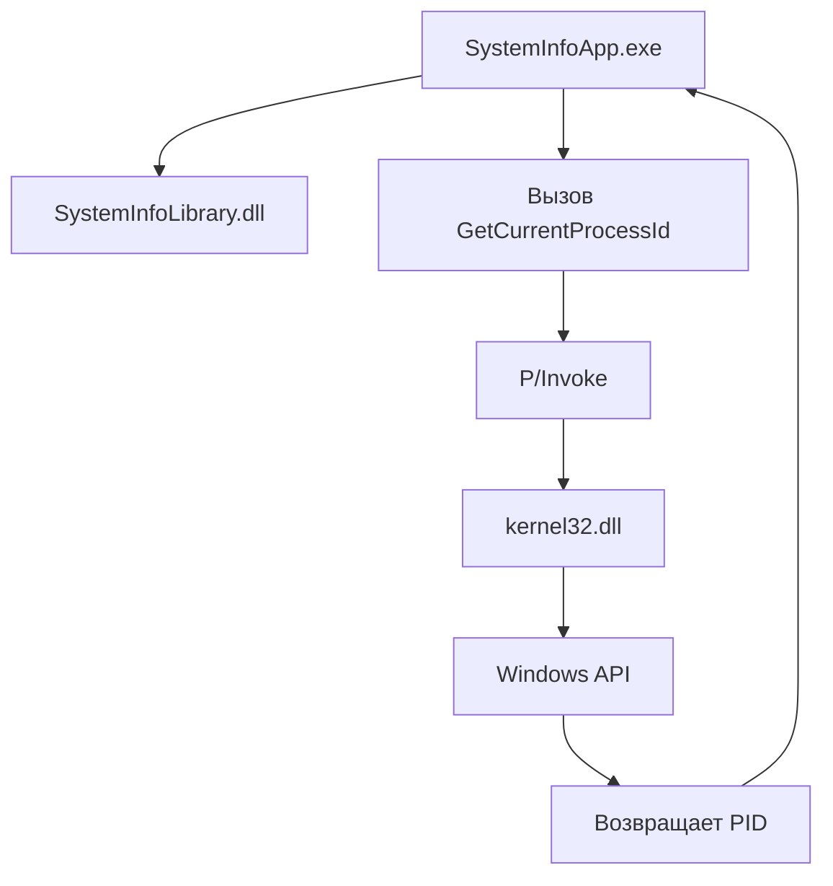

## Теория

### Что такое DLL

DLL (Dynamic Link Library) - динамически подключаемая библиотека. Она содержит код или данные, которые могут использовать другие программы.
Например, вместо того чтобы реализовывать одну и ту же функциональность в нескольких приложениях, можно вынести её в отдельную библиотеку.


В Windows DLL обычно имеет расширение `.dll`.
Но важно понимать: не каждая DLL устроена одинаково. В контексте .NET нужно различать управляемые и нативные библиотеки.
#### что произойдёт, если два приложения будут содержать собственные копии одинакового кода?
```spoiler
код придётся поддерживать и исправлять в двух местах. Общая библиотека позволяет вынести эту функциональность в один компонент.
```
### Управляемая сборка .NET

Управляемая сборка .NET - файл, содержащий код и метаданные, предназначенные для работы в среде .NET.
Например, проект типа `Class Library` создаёт файл:

```
SystemInfoLibrary.dll
```

Внутри находятся:
- промежуточный язык IL;
- метаданные типов;
- сведения о зависимостях;
- информация, необходимая среде .NET для выполнения кода.

Управляемый код выполняется под управлением CLR (Common Language Runtime).

Схематично:


При этом файл `.dll` не обязательно является библиотекой .NET. Расширение само по себе не определяет тип DLL.
#### если переименовать обычный текстовый файл в `.dll`, станет ли он сборкой .NET?
```spoiler
Нет. Расширение файла не превращает его содержимое в управляемую сборку.
```
### Class Library и Project Reference

Class Library - тип проекта .NET, предназначенный для создания библиотек классов.

В Visual Studio:

1. Создаём решение.
2. Добавляем проект типа Class Library.
3. Добавляем в него классы и методы.
4. Подключаем библиотеку к приложению.

```cs
// Для подключения используется ссылка на проект - `Project Reference`.
dotnet add SystemInfoApp reference SystemInfoLibrary
```

При сборке приложение получает необходимую зависимость, а DLL библиотеки попадает в выходной каталог приложения.

#### Что произойдёт, если удалить ссылку на библиотеку, но оставить `using SystemInfoLibrary`?
```spoiler
Компилятор не сможет найти типы из этой библиотеки, если другая подходящая ссылка не подключена.
```
### P/Invoke

P/Invoke (Platform Invocation Services) - механизм .NET, позволяющий вызывать функции из неуправляемых библиотек, например из Windows API.

Например, Windows предоставляет функцию:

```
DWORD GetCurrentProcessId(void);
```

Она возвращает идентификатор текущего процесса.

В C# можно объявить соответствующий метод:

```cs
using System.Runtime.InteropServices;

// `DllImport` указывает, из какой нативной библиотеки нужно получить функцию
// `EntryPoint` - Имя экспортируемой функции
// `CallingConvention` - Соглашение о вызове
// `extern` означает, что реализация метода находится вне C#-кода
// `uint` соответствует типу `DWORD` в Windows API
// `GetCurrentProcessId` - имя функции, которую нужно вызвать
[DllImport(
    "kernel32.dll",
    EntryPoint = "GetCurrentProcessId",
    CallingConvention = CallingConvention.Winapi)]
private static extern uint GetCurrentProcessId();
```

Примеры соответствия типов для Windows API:

| Windows API | C#                                                               |
| ----------- | ---------------------------------------------------------------- |
| `DWORD`     | `uint`                                                           |
| `BOOL`      | `int` или специально объявленный `bool` с корректным маршалингом |
| `HANDLE`    | `IntPtr` или `SafeHandle`                                        |
| `LPCWSTR`   | `string` с соответствующими параметрами маршалинга               |

Нельзя автоматически заменять любой нативный тип на похожий C#-тип. Нужно учитывать размер, представление и правила передачи данных.
#### Что произойдёт, если указать неправильное имя функции?
```spoiler
При вызове можно получить `EntryPointNotFoundException`.
```


### Разрядность и платформенные ограничения

Процесс может выполняться в разных архитектурах:

- x86 - 32-битная;
- x64 - 64-битная;
- ARM64 - 64-битная архитектура ARM.
- V-RISC

Для управляемого кода .NET часто можно использовать `Any CPU`, но это не означает, что любая нативная DLL подходит для любой архитектуры.

Главное правило: нативная библиотека, загружаемая в процесс, должна быть совместима с архитектурой этого процесса.

Например:
- 64-битное приложение не может напрямую загрузить 32-битную нативную DLL;
- 32-битное приложение не может напрямую загрузить 64-битную нативную DLL.

При несовместимости можно получить `BadImageFormatException`.

В нашем проекте используется `kernel32.dll` - системная библиотека Windows. Windows предоставляет подходящую системную реализацию для архитектуры процесса.
Ограничение: P/Invoke для `kernel32.dll` - решение для Windows. На Linux и macOS такой вызов не будет работать.

## П1

Создадим решение:

```
mkdir DllCourse
cd DllCourse

dotnet new sln -n DllCourse
```

Создадим библиотеку:

```
dotnet new classlib -n SystemInfoLibrary -f net9.0
```

Создадим консольное приложение:

```
dotnet new console -n SystemInfoApp -f net9.0-windows
```

Добавим проекты в решение:

```
dotnet sln add SystemInfoLibrary/SystemInfoLibrary.csproj
dotnet sln add SystemInfoApp/SystemInfoApp.csproj
```

Подключим библиотеку к приложению:

```
dotnet add SystemInfoApp/SystemInfoApp.csproj reference SystemInfoLibrary/SystemInfoLibrary.csproj
```

Получится структура:

```
DllCourse/
│
├── DllCourse.sln
│
├── SystemInfoLibrary/
│   ├── SystemInfoLibrary.csproj
│   └── Class1.cs
│
└── SystemInfoApp/
    ├── SystemInfoApp.csproj
    └── Program.cs
```

### Реализация библиотеки

Удалить `Class1.cs`.

Создать файл `SystemInfo.cs`:

```cs

namespace SystemInfoLibrary;
// Здесь находится обычный управляемый C#-код.
public sealed class SystemInfo
{
    public string GetApplicationName()
    {
        return "Student System Programming";
    }

    public string GetLibraryVersion()
    {
        return "1.0.0";
    }
}
```


При сборке проекта будет создан файл:

```
SystemInfoLibrary.dll
```

Это управляемая сборка .NET, а не нативная DLL Windows API.

### Реализация P/Invoke

В проекте `SystemInfoApp` создать каталог `Interop`.

Внутри создать файл `WindowsApi.cs`:

```cs

using System.Runtime.InteropServices;

namespace SystemInfoApp.Interop;

public static class WindowsApi
{
    [DllImport(
        "kernel32.dll",
        EntryPoint = "GetCurrentProcessId",
        CallingConvention = CallingConvention.Winapi)]
    public static extern uint GetCurrentProcessId();
}
```

Разберём объявление:

```cs
[DllImport("kernel32.dll")]
```

.NET должен найти функцию в системной библиотеке Windows.

```cs
public static extern uint GetCurrentProcessId();
```

В C# мы объявили сигнатуру метода, но не написали его реализацию. Реализация находится в нативной библиотеке.

Почему возвращаемый тип `uint`?

В Windows API функция возвращает `DWORD`, а `DWORD` - 32-битное беззнаковое целое число.

Почему не `int`?

`int` в C# - знаковое 32-битное число. Для `DWORD` правильнее использовать `uint`.

### Реализация Program.cs

Полностью заменить содержимое `Program.cs`:

```cs

using SystemInfoApp.Interop;
using SystemInfoLibrary;

Console.WriteLine("Информация о приложении");
Console.WriteLine("-----------------------");

// Получаем информацию из управляемой DLL.
var systemInfo = new SystemInfo();

Console.WriteLine(
    $"Название: {systemInfo.GetApplicationName()}");

Console.WriteLine(
    $"Версия библиотеки: {systemInfo.GetLibraryVersion()}");

// Получаем PID через нативную Windows DLL.
uint processId = WindowsApi.GetCurrentProcessId();

Console.WriteLine($"PID процесса: {processId}");

Console.WriteLine();
Console.WriteLine("Нажмите Enter для завершения.");
Console.ReadLine();
```

### Запуск

```
dotnet build
dotnet run --project SystemInfoApp
```

Пример результата:

```
Информация о приложении
-----------------------
Название: Student System Programming
Версия библиотеки: 1.0.0
PID процесса: 15432

Нажмите Enter для завершения.
```

PID будет отличаться при каждом запуске.

### Что происходит при выполнении

Здесь есть два разных механизма:
1. `SystemInfoLibrary.dll` - управляемая сборка .NET, с которой работает CLR.
2. `kernel32.dll` - нативная системная библиотека Windows, функцию из которой мы вызываем через P/Invoke.

### Задания

1. Изменить название приложения в `SystemInfoLibrary`.
2. Изменить версию библиотеки на `1.1.0`.
3. Запустить приложение и проверить, что изменения появились.
4. Изменить имя `EntryPoint` на `GetCurrentProcessIdWrong` и проверить, какая ошибка возникает при вызове.
5. Вернуть правильное имя и убедиться, что программа снова работает.
6. Удалить `Project Reference` и попробовать собрать приложение.
7. Восстановить ссылку и повторить сборку.


## П2

### Задача

Добавить в библиотеку второй метод, создать ещё одно приложение и использовать ту же DLL без копирования исходного кода библиотеки.

Таким образом, студенты увидят, зачем выносить функциональность в отдельную сборку.

### `SystemInfo.cs`
```cs
// добавить метод
public string GetRuntimeDescription()
{
    return $".NET {Environment.Version}";
}
```

Теперь библиотека предоставляет три метода:

| Метод                     | Назначение                     |
| ------------------------- | ------------------------------ |
| `GetApplicationName()`    | Возвращает название приложения |
| `GetLibraryVersion()`     | Возвращает версию библиотеки   |
| `GetRuntimeDescription()` | Возвращает версию .NET Runtime |
|                           |                                |

Обратите внимание: версия библиотеки и версия .NET Runtime - разные понятия.

### Создать второе приложение

В корне решения выполнить:

```
dotnet new console -n SystemInfoSecondApp -f net9.0-windows
```

Добавить проект в решение:

```
dotnet sln add SystemInfoSecondApp/SystemInfoSecondApp.csproj
```

Подключить ту же библиотеку:

```
dotnet add SystemInfoSecondApp/SystemInfoSecondApp.csproj reference SystemInfoLibrary/SystemInfoLibrary.csproj
```

Итоговая структура:

```
DllCourse/
│
├── DllCourse.sln
│
├── SystemInfoLibrary/
│   ├── SystemInfoLibrary.csproj
│   └── SystemInfo.cs
│
├── SystemInfoApp/
│   ├── SystemInfoApp.csproj
│   ├── Program.cs
│   └── Interop/
│       └── WindowsApi.cs
│
└── SystemInfoSecondApp/
    ├── SystemInfoSecondApp.csproj
    └── Program.cs
```

### Реализовать второе приложение

В `SystemInfoSecondApp/Program.cs`:

```cs

using SystemInfoLibrary;

var systemInfo = new SystemInfo();

Console.WriteLine("Второе приложение");
Console.WriteLine("------------------");

Console.WriteLine(
    $"Название: {systemInfo.GetApplicationName()}");

Console.WriteLine(
    $"Версия библиотеки: {systemInfo.GetLibraryVersion()}");

Console.WriteLine(
    $"Среда выполнения: {systemInfo.GetRuntimeDescription()}");
```

Запуск:

```
dotnet run --project SystemInfoSecondApp
```

Второе приложение использует ту же библиотеку, что и первое.

### Проверить повторное использование DLL

Выполнить:

```
dotnet build
```

Посмотреть содержимое каталогов:

```
SystemInfoApp/bin/Debug/net9.0-windows/
SystemInfoSecondApp/bin/Debug/net9.0-windows/
```

В выходных каталогах должны присутствовать:

```
SystemInfoLibrary.dll
```

Это происходит потому, что оба проекта имеют ссылку на библиотеку. При сборке .NET разрешает зависимость и копирует необходимую сборку в выходной каталог приложения.

Важно: `Project Reference` - ссылка на проект, а не просто команда копирования файла. Сборочная система учитывает зависимость и может пересобирать библиотеку при изменении её исходного кода.

### Задания

1. Добавить в библиотеку метод `GetComputerName()`, возвращающий имя компьютера через `Environment.MachineName`.
2. Использовать новый метод в обоих приложениях.
3. Изменить возвращаемую версию библиотеки на `1.2.0`.
4. Убедиться, что оба приложения отображают новую версию после сборки.
5. Удалить ссылку на библиотеку из второго приложения и проверить ошибку компиляции.
6. Восстановить ссылку и повторить запуск.

Задание повышенной сложности: добавить третий проект `SystemInfoThirdApp`, подключить библиотеку и самостоятельно использовать все четыре метода.

### Платформенные ограничения

В первом приложении есть вызов:

```
WindowsApi.GetCurrentProcessId();
```

Он зависит от Windows API.

Во втором приложении используется только управляемая библиотека:

```
Environment.Version
Environment.MachineName
```

Поэтому библиотека `SystemInfoLibrary` может использоваться на разных платформах .NET, а первое приложение с `kernel32.dll` - только в Windows.

Для демонстрации можно предложить студентам ответить:
- Почему `SystemInfoLibrary` можно использовать в Linux?
- Почему вызов `GetCurrentProcessId` из `kernel32.dll` не будет работать в Linux?
- Что произойдёт, если подключить нативную DLL неправильной разрядности?
- Почему нельзя считать все файлы `.dll` управляемыми сборками?

### Типичные ошибки

|Ошибка|Причина|Что проверить|
|---|---|---|
|`CS0246`|Не найдена библиотека или пространство имён|`Project Reference`, `using`|
|`DllNotFoundException`|Не найдена нативная библиотека|Имя DLL, архитектура, пути загрузки|
|`EntryPointNotFoundException`|Не найдена функция в DLL|`EntryPoint`, имя экспорта|
|`BadImageFormatException`|Несовместимый формат или архитектура DLL|x86/x64/ARM64|
|`PlatformNotSupportedException`|Функция недоступна на платформе|Ограничения ОС|
|`AccessViolationException`|Ошибка при взаимодействии с памятью через неверное объявление или указатели|Сигнатура, маршалинг, время жизни указателей|

### Контрольные сценарии

|Проверка|Ожидаемый результат|
|---|---|
|Запустить первое приложение|Отображаются данные библиотеки и PID|
|Запустить второе приложение|Отображаются данные той же библиотеки|
|Изменить метод в библиотеке|После пересборки изменения доступны обоим приложениям|
|Удалить Project Reference|Ошибка компиляции при использовании типов библиотеки|
|Указать неправильный EntryPoint|Ошибка при разрешении внешней функции|
|Запустить Windows API-вызов на неподдерживаемой ОС|Вызов не работает, поскольку библиотека Windows недоступна|

## Домашнее задание

Тема: изменение версии библиотеки и совместимость приложений-потребителей.

Представим, что библиотека `SystemInfoLibrary` используется тремя приложениями.

Разработчик изменил библиотеку:

- версия `1.0.0` - есть методы `GetApplicationName()` и `GetLibraryVersion()`;
- версия `1.1.0` - добавлен `GetRuntimeDescription()`;
- версия `2.0.0` - метод `GetApplicationName()` переименован в `GetProductName()`.

Задания:

1. Объяснить, что произойдёт с приложениями, которые используют старую версию библиотеки.
2. Объяснить разницу между добавлением нового метода и удалением или переименованием существующего.
3. Определить, какие изменения являются обратно совместимыми.
4. Объяснить, почему изменение библиотеки может потребовать пересборки приложения-потребителя.
5. Предложить способ сохранить совместимость при переходе с версии 1.0.0 на 2.0.0.

Дополнительная практика: реализовать `GetProductName()`, но временно оставить `GetApplicationName()` как метод-обёртку, который вызывает новый метод.

Пример:

```cs
public string GetProductName()
{
    return "Student System Programming";
}

public string GetApplicationName()
{
    return GetProductName();
}
```

Так старые приложения продолжат работать с прежним методом, а новые смогут использовать новый API.
