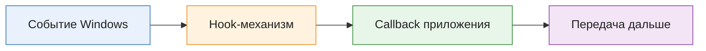
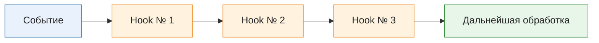
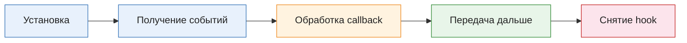
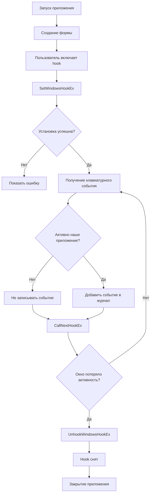
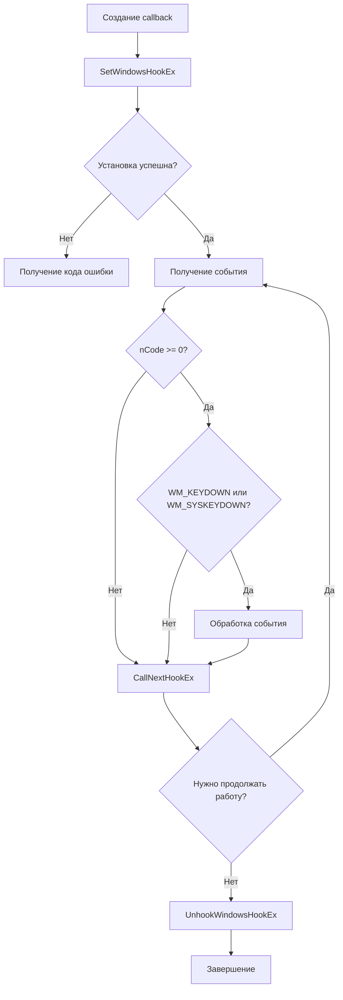

## Теория

### Сообщения Windows

Windows использует событийную модель взаимодействия с окнами.
Когда пользователь нажимает клавишу, операционная система формирует сообщения, которые могут быть переданы окну приложения.

Например:

|Сообщение|Значение|
|---|---|
|`WM_KEYDOWN`|Клавиша нажата|
|`WM_KEYUP`|Клавиша отпущена|
|`WM_SYSKEYDOWN`|Нажата системная клавиша, например Alt|
|`WM_SYSKEYUP`|Отпущена системная клавиша|

В Windows Forms и WPF разработчику обычно не нужно самостоятельно разбирать все сообщения. Фреймворк предоставляет более удобные события.

Например, Windows Forms:

```
private void Form1_KeyDown(
    object? sender,
    KeyEventArgs e)
{
    Console.WriteLine(e.KeyCode);
}
```

В WPF аналогичная задача решается через `KeyDown`:

```
private void Window_KeyDown(
    object sender,
    KeyEventArgs e)
{
    MessageBox.Show(e.Key.ToString());
}
```

#### если окно приложения не находится в фокусе, получит ли оно обычное событие `KeyDown` от нажатия клавиши?
```spoiler
Нет. Обычные события клавиатуры относятся к активному окну и его элементам управления.
```
### Что такое hook

механизм Windows, позволяющий приложению получать уведомления об определённых событиях или сообщениях и выполнять собственный callback.

Упрощённая схема:



В зависимости от типа hook он может наблюдать за сообщениями определённого потока, окна или системными событиями.

Для клавиатуры существуют, в частности:

- `WH_KEYBOARD` - наблюдение за клавиатурными сообщениями в контексте потока;
- `WH_KEYBOARD_LL` - низкоуровневый клавиатурный hook.

#### чем hook отличается от обычного `KeyDown`?
```spoiler
`KeyDown` - событие фреймворка для собственного окна. Hook - системный механизм Windows, который позволяет получать уведомления на более низком уровне.
```
### Hook-цепочка

Некоторые типы hook образуют цепочки обработчиков.

Если событие попадает в такую цепочку, обработчик может передать его следующему участнику.

Для этого используется:

```
CallNextHookEx(...)
```

Упрощённо:



Что произойдёт, если обработчик не передаст событие дальше?

Для некоторых типов hook это может повлиять на дальнейшую обработку сообщения. Поэтому без специальной причины нельзя блокировать события.

В нашем проекте все события будут передаваться дальше.

Важно: у `WH_KEYBOARD_LL` есть особенность - callback вызывается в контексте потока, установившего hook, через механизм сообщений. Это не означает, что нужно самостоятельно вызывать `CallNextHookEx` для продолжения цепочки в отдельном потоке.

### SetWindowsHookEx

функция Windows API для установки hook.

Общая сигнатура:
```
HHOOK SetWindowsHookEx(
    int idHook,
    HOOKPROC lpfn,
    HINSTANCE hmod,
    DWORD dwThreadId
);
```

Для низкоуровневого клавиатурного hook используется:
```
const int WH_KEYBOARD_LL = 13;
```

Вызов из C#:

```cs
SetWindowsHookEx(
    WH_KEYBOARD_LL, // тип hook
    callback, // функция, которую вызовет Windows
    IntPtr.Zero, // для этого низкоуровневого hook используется нулевой дескриптор модуля
    0 // hook устанавливается для системных событий, а не одного потока
    ); 
```

Возвращаемое значение - дескриптор hook. Если установка не удалась, возвращается `IntPtr.Zero`.

#### что произойдёт, если не проверить результат установки?
```spoiler
Приложение может считать, что hook работает, хотя на самом деле он не был установлен.
```
### CallNextHookEx и UnhookWindowsHookEx

`CallNextHookEx` передаёт уведомление следующему обработчику.
`UnhookWindowsHookEx` снимает ранее установленный hook.

```cs
UnhookWindowsHookEx(hookHandle);
```

У hook есть жизненный цикл:



Если забыть снять hook, то Hook может оставаться установленным, пока существует процесс, а приложение продолжит получать ненужные системные уведомления.

Поэтому снятие должно выполняться:
- при отключении функции;
- при потере активности окна, если hook нужен только активному окну;
- при закрытии приложения.

### Безопасная очистка

При работе с P/Invoke недостаточно просто вызвать `SetWindowsHookEx`.

Нужно учитывать:
1. Жизненный цикл дескриптора. Установленный hook необходимо снять.
2. Жизненный цикл делегата. Callback должен оставаться доступным для нативного кода. Поэтому делегат хранится в поле объекта, а не создаётся временно внутри метода.
3. Время выполнения callback. Нельзя выполнять длительную работу в обработчике низкоуровневого hook. Медленный callback может привести к задержкам обработки клавиатуры и даже к удалению hook системой.
4. Передача события дальше. Если приложение не собирается блокировать событие, оно должно вызывать `CallNextHookEx`.
5. Границы доверия. Нельзя считать данные от системного callback поводом выполнять произвольные действия или запускать команды.

#### почему нельзя записывать в callback большой файл или выполнять долгую операцию?
```spoiler
Потому что callback участвует в обработке системного события и должен завершаться быстро.
```
## П1

Создать Windows Forms-приложение, которое отображает нажатия клавиш, пока пользователь работает с его окном.
### Создание проекта

Для этой практики используем Windows Forms: у него простой цикл обработки сообщений, а события клавиатуры удобно демонстрировать без дополнительной разметки XAML.

Выполнить в терминале Windows:

```
dotnet new winforms -n KeyboardHookLab -f net9.0
cd KeyboardHookLab
```

Если шаблон создал проект с целевой платформой `net9.0-windows`, это нормально. В файле `KeyboardHookLab.csproj` должно быть:

```
<Project Sdk="Microsoft.NET.Sdk">

  <PropertyGroup>
    <OutputType>WinExe</OutputType>
    <TargetFramework>net9.0-windows</TargetFramework>
    <UseWindowsForms>true</UseWindowsForms>
    <Nullable>enable</Nullable>
    <ImplicitUsings>enable</ImplicitUsings>
  </PropertyGroup>

</Project>
```

Структура проекта:

```
KeyboardHookLab/
├── KeyboardHookLab.csproj
├── Program.cs
├── MainForm.cs
└── Interop/
    └── KeyboardHook.cs
```

### `Program.cs`
```cs
namespace KeyboardHookLab;

// `Application.Run()` запускает цикл обработки сообщений Windows Forms. 
// Пока окно работает, приложение получает и обрабатывает сообщения, в том числе связанные с клавиатурой.
internal static class Program
{
    [STAThread]
    static void Main()
    {
        ApplicationConfiguration.Initialize();
        Application.Run(new MainForm());
    }
}
```

### Первая версия `MainForm.cs`
```cs
namespace KeyboardHookLab;

// На первом этапе создадим окно с журналом клавиатурных событий.
public sealed class MainForm : Form
{
    private readonly TextBox _logTextBox;

    public MainForm()
    {
        Text = "Keyboard Events";
        Width = 700;
        Height = 450;
        StartPosition = FormStartPosition.CenterScreen;

        // Форма получает события клавиатуры раньше дочерних элементов.
        KeyPreview = true;

        _logTextBox = new TextBox
        {
            Multiline = true,
            ReadOnly = true,
            Dock = DockStyle.Fill,
            ScrollBars = ScrollBars.Vertical
        };

        Controls.Add(_logTextBox);

        KeyDown += OnKeyDown;
    }

    private void OnKeyDown(object? sender, KeyEventArgs e)
    {
        _logTextBox.AppendText(
            $"Нажата клавиша: {e.KeyCode}{Environment.NewLine}");
    }
}
```

### Проверка

Запустить:

```
dotnet run
```

Проверить:
1. Нажать несколько клавиш, когда окно активно.
2. Переключиться в Блокнот.
3. Нажать несколько клавиш в Блокноте.
4. Вернуться в наше приложение.

Ожидаемый результат: приложение отображает события только тогда, когда его окно активно.

### Что делает KeyPreview

```cs
KeyPreview = true;
```

По умолчанию клавиатурные события в Windows Forms в первую очередь обрабатываются элементом управления, который имеет фокус.
`KeyPreview = true` позволяет форме получать клавиатурные события до их обработки активным дочерним элементом.
Например, если позднее добавить `TextBox`, форма всё равно сможет получать `KeyDown`.

Задания студентам:
1. Добавить обработчик `KeyUp`.
2. Выводить отдельно нажатие и отпускание клавиши.
3. Добавить обработчик клавиши Escape, который очищает журнал.
4. Проверить, что при переключении в другое приложение события больше не поступают.
5. Объяснить, чем `KeyPreview` отличается от системного hook.

## П2

Расширить приложение:
1. Добавить время каждого события.
2. Добавить кнопку очистки журнала.
3. Добавить переключатель включения низкоуровневого hook.
4. Устанавливать hook только при активном окне приложения.
5. Снимать hook при потере активности окна и закрытии приложения.
6. Обрабатывать ошибки установки и снятия hook.


### `KeyboardHook.cs`

Создать каталог `Interop` и файл `KeyboardHook.cs`.
```cs

using System.ComponentModel;
using System.Diagnostics;
using System.Runtime.InteropServices;
using System.Windows.Forms;

namespace KeyboardHookLab.Interop;
// Это класс-обёртка над Windows API. Он отвечает за установку hook, получение уведомлений и освобождение дескриптора.
public sealed class KeyboardHook : IDisposable
{
// Тип hook
// Число `13` - идентификатор низкоуровневого клавиатурного hook в Windows API.
    private const int WH_KEYBOARD_LL = 13;

    private const int WM_KEYDOWN = 0x0100;
    private const int WM_SYSKEYDOWN = 0x0104;

	// Windows вызывает этот метод при поступлении подходящего клавиатурного события.
    private delegate IntPtr LowLevelKeyboardProc(
        int nCode, // код обработки hook
        IntPtr wParam, // тип сообщения, например `WM_KEYDOWN`
        IntPtr lParam); // указатель на структуру с информацией о клавише


    // Windows получает адрес callback. 
    // Если делегат не удерживать ссылкой в управляемом коде, 
    // сборщик мусора может его освободить, 
    // пока нативная сторона ещё рассчитывает на него.
    private readonly LowLevelKeyboardProc _callback;

    private IntPtr _hookHandle = IntPtr.Zero;

    public event Action<Keys>? KeyPressed;

    public bool IsInstalled =>
        _hookHandle != IntPtr.Zero;

    public KeyboardHook()
    {
        _callback = HookCallback;
    }

    public void Start()
    {
        if (IsInstalled)
            return;

        _hookHandle = SetWindowsHookEx(
            WH_KEYBOARD_LL,
            _callback,
            IntPtr.Zero,
            0);

        if (_hookHandle == IntPtr.Zero)
        {
            int errorCode = Marshal.GetLastWin32Error();

            throw new Win32Exception(
                errorCode,
                "Не удалось установить клавиатурный hook.");
        }
    }

    public void Stop()
    {
        if (!IsInstalled)
            return;

        bool success = UnhookWindowsHookEx(_hookHandle);

        if (!success)
        {
            int errorCode = Marshal.GetLastWin32Error();

            throw new Win32Exception(
                errorCode,
                "Не удалось снять клавиатурный hook.");
        }

        _hookHandle = IntPtr.Zero;
    }

    private IntPtr HookCallback(
        int nCode,
        IntPtr wParam,
        IntPtr lParam)
    {
        if (nCode >= 0 &&
            (wParam == (IntPtr)WM_KEYDOWN ||
             wParam == (IntPtr)WM_SYSKEYDOWN))
        {
            try
            {
            
	            // Структура события
				// `lParam` содержит указатель на нативную структуру. 
				// `Marshal.PtrToStructure` преобразует её в управляемую структуру C#.
				// Поле `vkCode` содержит виртуальный код клавиши.
                var keyboardInfo =
                    Marshal.PtrToStructure<KBDLLHOOKSTRUCT>(lParam);

                IntPtr foregroundWindow = GetForegroundWindow();

                if (foregroundWindow != IntPtr.Zero)
                {
                    GetWindowThreadProcessId(
                        foregroundWindow,
                        out uint processId);

                    // Обрабатываем только события нашего процесса.
                    // Hook низкого уровня может получать события, относящиеся к разным приложениям.
                    // Поэтому мы проверяем PID активного окна и обрабатываем только события собственного процесса.
                    if (processId == (uint)Environment.ProcessId)
                    {
                        Keys key = (Keys)keyboardInfo.vkCode;

                        KeyPressed?.Invoke(key);
                    }
                }
            }
            catch (Exception ex)
            {
                // Исключение не должно выйти через границу
                // управляемого и неуправляемого callback.
                Debug.WriteLine(
                    $"Ошибка callback клавиатуры: {ex}");
            }
        }

        // Не блокируем событие: передаём его дальше.
        return CallNextHookEx(
            _hookHandle,
            nCode,
            wParam,
            lParam);
    }

    public void Dispose()
    {
        Stop();
    }

    [StructLayout(LayoutKind.Sequential)]
    private struct KBDLLHOOKSTRUCT
    {
        public uint vkCode;
        public uint scanCode;
        public uint flags;
        public uint time;
        public UIntPtr dwExtraInfo;
    }

    [DllImport(
        "user32.dll",
        SetLastError = true,
        CallingConvention = CallingConvention.Winapi)]
    private static extern IntPtr SetWindowsHookEx(
        int idHook,
        LowLevelKeyboardProc callback,
        IntPtr hMod,
        uint dwThreadId);

    [DllImport(
        "user32.dll",
        SetLastError = true,
        CallingConvention = CallingConvention.Winapi)]
    [return: MarshalAs(UnmanagedType.Bool)]
    private static extern bool UnhookWindowsHookEx(
        IntPtr hhk);

    [DllImport(
        "user32.dll",
        CallingConvention = CallingConvention.Winapi)]
    private static extern IntPtr CallNextHookEx(
        IntPtr hhk,
        int nCode,
        IntPtr wParam,
        IntPtr lParam);

    [DllImport(
        "user32.dll",
        CallingConvention = CallingConvention.Winapi)]
    private static extern IntPtr GetForegroundWindow();

    [DllImport(
        "user32.dll",
        CallingConvention = CallingConvention.Winapi)]
    private static extern uint GetWindowThreadProcessId(
        IntPtr hWnd,
        out uint processId);
}
```

### Полностью заменить MainForm.cs
```cs

using System.Diagnostics;
using System.Windows.Forms;
using KeyboardHookLab.Interop;

namespace KeyboardHookLab;
// Теперь добавим журнал с временем, кнопку очистки и управление hook.
public sealed class MainForm : Form
{
    private readonly TextBox _logTextBox;
    private readonly CheckBox _hookCheckBox;
    private readonly Label _statusLabel;
    private readonly KeyboardHook _keyboardHook;

    public MainForm()
    {
        Text = "Keyboard Hook Laboratory";
        Width = 850;
        Height = 500;
        StartPosition = FormStartPosition.CenterScreen;

        KeyPreview = true;

        _keyboardHook = new KeyboardHook();
        _keyboardHook.KeyPressed += OnHookKeyPressed;

        _logTextBox = new TextBox
        {
            Multiline = true,
            ReadOnly = true,
            Dock = DockStyle.Fill,
            ScrollBars = ScrollBars.Vertical
        };

        _hookCheckBox = new CheckBox
        {
            Text = "Включить low-level hook",
            AutoSize = true,
            Margin = new Padding(8)
        };

        var clearButton = new Button
        {
            Text = "Очистить журнал",
            AutoSize = true
        };

        _statusLabel = new Label
        {
            Text = "Hook не установлен",
            AutoSize = true,
            Margin = new Padding(8)
        };

        var toolbar = new FlowLayoutPanel
        {
            Dock = DockStyle.Top,
            AutoSize = true,
            WrapContents = false
        };

        toolbar.Controls.Add(_hookCheckBox);
        toolbar.Controls.Add(clearButton);
        toolbar.Controls.Add(_statusLabel);

        Controls.Add(_logTextBox);
        Controls.Add(toolbar);

        KeyDown += OnLocalKeyDown;

        clearButton.Click += (_, _) =>
        {
            _logTextBox.Clear();
        };

        _hookCheckBox.CheckedChanged += OnHookCheckedChanged;

        Activated += OnFormActivated;
        Deactivate += OnFormDeactivated;
        FormClosing += OnFormClosing;
    }

    private void OnLocalKeyDown(object? sender, KeyEventArgs e)
    {
        AppendLog(
            "WinForms",
            e.KeyCode.ToString());
    }

    private void OnHookKeyPressed(Keys key)
    {
        if (IsDisposed || !IsHandleCreated)
            return;

        try
        {
            // Обновляем интерфейс через очередь сообщений формы.
            BeginInvoke(new Action(() =>
            {
                if (!IsDisposed)
                {
                    AppendLog(
                        "Low-level hook",
                        key.ToString());
                }
            }));
        }
        catch (InvalidOperationException ex)
        {
            Debug.WriteLine(
                $"Не удалось обновить журнал: {ex}");
        }
    }

    private void AppendLog(string source, string key)
    {
        string timestamp =
            DateTimeOffset.Now.ToString("HH:mm:ss.fff");

        _logTextBox.AppendText(
            $"[{timestamp}] [{source}] {key}" +
            Environment.NewLine);
    }

    private void OnHookCheckedChanged(
        object? sender,
        EventArgs e)
    {
        if (_hookCheckBox.Checked)
        {
            if (Form.ActiveForm == this)
                StartHook();
        }
        else
        {
            StopHook();
        }
    }

    private void OnFormActivated(
        object? sender,
        EventArgs e)
    {
        if (_hookCheckBox.Checked)
            StartHook();
    }

    private void OnFormDeactivated(
        object? sender,
        EventArgs e)
    {
        StopHook();
    }

    private void StartHook()
    {
        if (_keyboardHook.IsInstalled)
            return;

        try
        {
            _keyboardHook.Start();

            _statusLabel.Text = "Hook установлен";
            AppendLog("System", "Hook установлен");
        }
        catch (Win32Exception ex)
        {
            _statusLabel.Text = "Ошибка установки hook";

            AppendLog(
                "Error",
                ex.Message);

            // Сбрасываем переключатель, чтобы UI отражал
            // фактическое состояние hook.
            _hookCheckBox.Checked = false;
        }
    }

    private void StopHook()
    {
        if (!_keyboardHook.IsInstalled)
            return;

        try
        {
            _keyboardHook.Stop();

            _statusLabel.Text = "Hook не установлен";
            AppendLog("System", "Hook снят");
        }
        catch (Win32Exception ex)
        {
            _statusLabel.Text = "Ошибка снятия hook";

            AppendLog(
                "Error",
                ex.Message);
        }
    }

    private void OnFormClosing(
        object? sender,
        FormClosingEventArgs e)
    {
        StopHook();

        try
        {
            _keyboardHook.Dispose();
        }
        catch (Win32Exception ex)
        {
            Debug.WriteLine(
                $"Ошибка освобождения hook: {ex}");
        }
    }
}
```

### Как теперь работает приложение

### Проверка работы

Запустить:

```
dotnet run
```

Проверить несколько сценариев:

|Действие|Ожидаемый результат|
|---|---|
|Нажать клавишу без hook|Запись с источником `WinForms`|
|Включить hook и нажать клавишу|Записи от обоих обработчиков|
|Переключиться в Блокнот|Hook снимается, события не записываются|
|Вернуться в приложение|Hook снова устанавливается, если переключатель включён|
|Очистить журнал|Все записи удаляются из поля|
|Закрыть приложение|Hook снимается|

Пример журнала:

```
[15:30:10.123] [WinForms] A
[15:30:10.124] [Low-level hook] A
[15:30:11.250] [WinForms] Enter
[15:30:11.251] [Low-level hook] Enter
[15:30:15.100] [System] Hook снят
```

Время в примере условное. При одновременном поступлении события два обработчика могут сработать практически подряд.

Почему одна клавиша отображается дважды?

Потому что одно событие наблюдают два разных механизма:
- Windows Forms обрабатывает его как `KeyDown`;
- низкоуровневый hook получает системное уведомление.

Это ожидаемое поведение демонстрации, а не ошибка.

### Задания

1. Добавить отображение `WM_SYSKEYDOWN` и проверить нажатие Alt.
2. Добавить счётчик событий клавиатуры.
3. Выводить общее количество событий в отдельном `Label`.
4. Сделать кнопку включения hook недоступной во время закрытия формы.
5. Проверить, что повторное включение hook не создаёт несколько экземпляров.
6. Проверить, что повторный вызов `Stop()` не приводит к ошибке.
7. Проверить, что после закрытия приложения события больше не обрабатываются.

Задание повышенной сложности: добавить фильтр, который позволяет отображать только функциональные клавиши (`F1`–`F12`), не записывая остальные.

## Типичные ошибки и их исправление

|Ошибка|Причина|Исправление|
|---|---|---|
|`DllNotFoundException`|Не найдена `user32.dll`|Проверить платформу: проект предназначен для Windows|
|`EntryPointNotFoundException`|Неправильное имя функции Windows API|Проверить имя WinAPI|
|`SetWindowsHookEx` возвращает `IntPtr.Zero`|Установка hook завершилась неудачно|Проверить `Marshal.GetLastWin32Error()`|
|`UnhookWindowsHookEx` возвращает `false`|Не удалось снять hook|Проверить дескриптор и код ошибки|
|Callback перестал работать|Делегат не удерживается от GC|Хранить делегат в поле|
|Приложение зависает при нажатии клавиши|Callback выполняет длительную работу|Оставить в callback только короткую обработку|
|Событие обрабатывается дважды|Одновременно работают `KeyDown` и hook|Различать источники событий|
|Hook продолжает работать после потери активности|Не реализовано снятие при `Deactivate`|Вызывать `UnhookWindowsHookEx`|
|Ошибка при повторном снятии|Не проверяется состояние hook|Проверять дескриптор перед снятием|

### Важные технические замечания преподавателю

1. `WH_KEYBOARD_LL` - системный низкоуровневый hook. В отличие от некоторых других видов hook, для него не требуется внедрять собственную DLL в адресное пространство других процессов.
2. Callback вызывается в контексте потока, который установил hook. Поэтому в нашем случае он связан с UI-потоком Windows Forms.
3. Callback должен завершаться быстро. Если он работает слишком долго, Windows может перестать вызывать hook.
4. `CallNextHookEx` передаёт событие дальше. В нашем проекте мы не блокируем нажатия.
5. Для `WH_KEYBOARD_LL` нельзя использовать обычный `KeyEventArgs`: нативная функция передаёт структуру `KBDLLHOOKSTRUCT`, которую нужно преобразовать через маршалинг.
6. `Environment.ProcessId` доступен в современных версиях .NET. В примере мы сравниваем PID активного окна с PID приложения. Поскольку в учебном проекте используется одна основная форма, этого достаточно для демонстрации. Для нескольких окон одного процесса лучше дополнительно сравнивать HWND активного окна с дескриптором конкретной формы.

Небольшая техническая поправка к `MainForm.cs`: в начало файла нужно добавить пространство имён для `Win32Exception`:

```
using System.ComponentModel;
```

Иначе компилятор не найдёт этот тип.

## Контрольные сценарии

|№|Сценарий|Ожидаемый результат|
|---|---|---|
|1|Запуск приложения|Окно открывается, hook не установлен|
|2|Нажатие клавиши без hook|Событие отображается через WinForms|
|3|Включение hook|Появляется сообщение об установке|
|4|Нажатие клавиши с hook|Событие отображается от двух источников|
|5|Переключение в другое приложение|Hook снимается|
|6|Возврат в учебное приложение|Hook устанавливается повторно, если переключатель включён|
|7|Очистка журнала|Журнал становится пустым|
|8|Закрытие окна|Hook снимается|
|9|Повторный вызов `Stop()`|Ошибки нет|
|10|Повторное включение hook|Работает только один установленный hook|

## Домашнее задание

Задача: нарисовать схему жизненного цикла низкоуровневого клавиатурного hook.

На схеме обязательно должны присутствовать:

1. Создание callback.
2. Вызов `SetWindowsHookEx`.
3. Проверка результата установки.
4. Получение события.
5. Проверка `nCode` и типа сообщения.
6. Обработка события.
7. Вызов `CallNextHookEx`.
8. Вызов `UnhookWindowsHookEx`.

Пример направления схемы:

Дополнительно в коде ответить:

1. Чем системный hook отличается от обычного события `KeyDown`?
2. Для чего нужен `CallNextHookEx`?
3. Почему callback должен работать быстро?
4. Зачем хранить делегат в поле?
5. Почему обязательно нужно вызывать `UnhookWindowsHookEx`?
6. Почему низкоуровневый hook нельзя считать обычным обработчиком событий окна?
